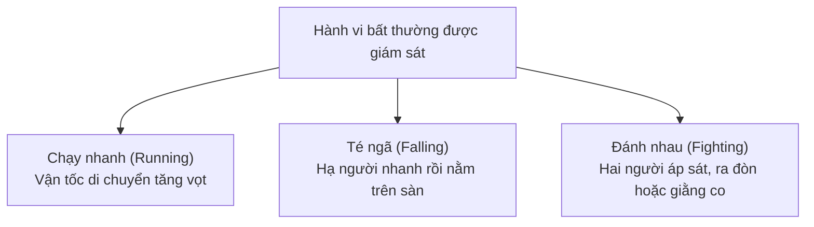

# CHƯƠNG 1: TỔNG QUAN VỀ BÀI TOÁN GIÁM SÁT VÀ PHÁT HIỆN HÀNH VI BẤT THƯỜNG

---

## 1.1. Đặt vấn đề và nhu cầu giám sát tự động

### 1.1.1. Bối cảnh thực tế
Số lượng camera giám sát (CCTV) tại đô thị, trường học, bệnh viện, nhà xưởng và toà nhà tăng rất nhanh, nhưng phần lớn hệ thống vẫn hoạt động theo cơ chế **giám sát thụ động**:
- **Ghi hình để tra cứu sau sự việc:** chỉ khi sự cố đã xảy ra, con người mới trích xuất video để tìm nguyên nhân.
- **Phụ thuộc vào người trực màn hình:** một người không thể theo dõi liên tục nhiều màn hình trong thời gian dài; sự tập trung giảm nhanh và các sự kiện ngắn (một cú ngã, một vụ xô xát vài giây) rất dễ bị bỏ sót.

### 1.1.2. Nhu cầu về hệ thống giám sát chủ động
Mục tiêu là chuyển từ giám sát thụ động sang **giám sát chủ động**:
- **Tự động nhận diện theo thời gian thực:** hệ thống phân tích hành vi con người trong khung hình liên tục, không cần người nhìn màn hình.
- **Cảnh báo tức thời:** khi phát hiện dấu hiệu bất thường, hệ thống phát âm thanh, hiển thị cảnh báo và lưu ảnh bằng chứng để người phụ trách xử lý kịp thời.

---

## 1.2. Ba hành vi bất thường được lựa chọn

Khái niệm "bất thường" phụ thuộc vào ngữ cảnh. Đề tài tập trung vào **ba hành vi thuộc nhóm hành động / động học**, là những hành vi có thể nhận biết từ chuyển động và tư thế cơ thể mà không cần biết trước bố cục hiện trường (không cần vẽ vùng cấm):

### 1.2.1. Chạy nhanh (Running)
- **Đặc trưng:** vận tốc di chuyển cao bất thường so với đi bộ, thường kèm thân người đổ về phía trước.
- **Ngữ cảnh:** truy đuổi, bỏ chạy, cướp giật, hoảng loạn do sự cố.
- **Nguyên lý phát hiện:** đo quãng đường tâm khung người dịch chuyển trong một cửa sổ thời gian ngắn rồi **chia cho chiều cao cơ thể trong ảnh**, thu được vận tốc tính bằng "số lần chiều cao cơ thể mỗi giây" (BH/s). Cách chuẩn hoá này làm giảm ảnh hưởng của hiệu ứng gần to – xa nhỏ: cùng một tốc độ thật cho giá trị gần như nhau dù người đứng gần hay xa camera.

### 1.2.2. Té ngã (Falling)
- **Đặc trưng:** tư thế chuyển nhanh từ thẳng đứng sang thấp/nằm ngang, trọng tâm hạ nhanh theo phương thẳng đứng, sau đó người nằm lại trên sàn.
- **Ngữ cảnh:** người già hoặc người bệnh ngã, tai nạn lao động, nạn nhân bị tấn công.
- **Nguyên lý phát hiện:** một máy trạng thái theo thời gian yêu cầu đủ hai pha liên tiếp — (1) hạ người nhanh, (2) giữ tư thế thấp/nằm ngang đủ lâu — mới phát cảnh báo. Yêu cầu cả hai pha giúp phân biệt ngã với cúi nhặt đồ hoặc ngồi xuống từ từ.

### 1.2.3. Đánh nhau (Fighting)
- **Đặc trưng:** hai người ở rất gần nhau, tay/chân chuyển động nhanh hướng vào vùng cơ thể đối phương, hoặc ôm vật giằng co, hoặc lao vào nhau.
- **Ngữ cảnh:** ẩu đả, hành hung, bạo lực học đường.
- **Nguyên lý phát hiện:** với mỗi cặp người đứng gần nhau, hệ thống kết hợp khoảng cách giữa hai người, vận tốc khớp tay/chân so với thân, mức độ giật lắc của thân và tốc độ áp sát. Đây là hành vi **khó nhất** trong ba hành vi vì phụ thuộc vào việc tách được hai bộ khung xương riêng biệt.

---

## 1.3. Các thách thức thực tế

| Thách thức | Mô tả | Tác động lên hệ thống |
| :--- | :--- | :--- |
| **Che khuất (Occlusion)** | Người bị che một phần hoặc toàn bộ bởi vật thể hay người khác. | Mất khớp xương, đứt chuỗi bám vết, đổi ID. Đặc biệt nghiêm trọng với đánh nhau: hai người vật lộn thường bị mô hình gộp thành **một** khung người. |
| **Phối cảnh (Perspective)** | Camera đặt cao nhìn xéo, người ở xa nhỏ hơn người ở gần. | Vận tốc tính bằng pixel không so sánh được giữa các vị trí; phải chuẩn hoá theo chiều cao cơ thể. Người di chuyển dọc theo trục nhìn của camera gần như không dịch chuyển trong ảnh. |
| **Hành vi dễ nhầm** | Cúi nhặt đồ, ngồi xổm, nằm nghỉ (giống ngã); đi nhanh (giống chạy); ôm, bắt tay, nhảy, chơi thể thao (giống đánh nhau). | Gây báo động giả. Cần điều kiện theo thời gian và tập âm tính khó để đánh giá. |
| **Ánh sáng** | Ngược sáng, ban đêm, bóng đổ. | Giảm độ chính xác ước lượng khớp xương. |
| **Tốc độ xử lý** | Cần xử lý liên tục và không tích luỹ độ trễ. | Tốc độ khung hình của khâu AI thay đổi theo phần cứng, nên mọi ngưỡng phải tính theo **thời gian thực (giây)**, không theo số khung hình. |

---

## 1.4. Phạm vi và mục tiêu của đề tài

### 1.4.1. Mục tiêu
Xây dựng một hệ thống phần mềm có khả năng:
1. Nhận video từ file, webcam hoặc camera IP (RTSP/HTTP).
2. Phát hiện người, ước lượng 17 khớp xương và bám vết từng người theo thời gian thực.
3. Phát hiện ba hành vi **Chạy nhanh**, **Té ngã**, **Đánh nhau**; khi phát hiện thì hiển thị cảnh báo trên giao diện web, phát âm thanh, lưu ảnh bằng chứng và ghi nhật ký sự kiện.

### 1.4.2. Phạm vi và giới hạn
- **Đối tượng:** con người (`person`).
- **Camera:** cố định (không xoay, không zoom), nhìn ngang hoặc nhìn xéo từ trên xuống, đủ sáng để thấy rõ cơ thể.
- **Không thuộc phạm vi:** phát hiện xâm nhập vùng cấm, lảng vảng, nhận diện khuôn mặt, tái định danh giữa nhiều camera.
- **Giới hạn đã biết:**
  - *Chạy dọc trục camera:* người chạy thẳng về phía camera hoặc ra xa gần như không dịch chuyển trong mặt phẳng ảnh, nên vận tốc đo được thấp hơn thực tế và có thể bị bỏ sót.
  - *Người đã nằm sẵn khi vào khung hình:* không có pha hạ người nên không được coi là ngã.
  - *Vật lộn sát nhau:* khi hai người bị gộp thành một khung, phương pháp theo cặp người không còn dữ liệu để so sánh.
  - *Góc nhìn thẳng từ trần xuống:* khung xương 2D không còn mang thông tin tư thế đứng/nằm.

### 1.4.3. Hướng tiếp cận
- Dùng mô hình **YOLOv8n-Pose** để phát hiện người và 17 khớp xương, kết hợp **ByteTrack** để bám vết.
- Phát hiện hành vi bằng **luật hình học – động học theo thời gian** trên khung người và khớp xương: dễ giải thích, dễ điều chỉnh, chạy nhanh trên CPU.
- Dự kiến bổ sung **mô hình học sâu** làm tầng xác minh cho các trường hợp luật không đủ tin cậy (xác minh té ngã bằng chuỗi khớp xương; phân loại đánh nhau). Trạng thái thực hiện của từng phần được ghi ở Chương 3 và Chương 4.
