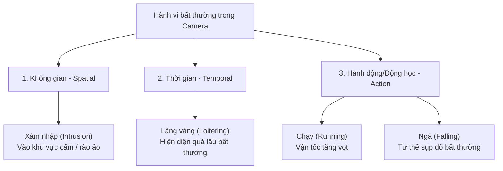

# CHƯƠNG 1: TỔNG QUAN VỀ BÀI TOÁN TRINH SÁT VÀ PHÁT HIỆN HÀNH VI BẤT THƯỜNG

---

## 1.1. Đặt vấn đề và nhu cầu giám sát an ninh tự động

### 1.1.1. Bối cảnh thực tế
Trong những năm gần đây, sự phát triển nhanh chóng của các đô thị, khu công nghiệp, ngân hàng và các tòa nhà thông minh kéo theo số lượng camera an ninh (CCTV) tăng trưởng theo cấp số nhân. Tuy nhiên, phần lớn các hệ thống camera hiện nay vẫn hoạt động theo cơ chế **giám sát thụ động**:
- **Ghi hình để tra cứu hồi tố (Forensic/Post-event analysis):** Khi sự cố mất an ninh trật tự hoặc tai nạn xảy ra, con người mới tiến hành trích xuất lại video để điều tra nguyên nhân.
- **Phụ thuộc vào nhân sự trực màn hình:** Các nghiên cứu chỉ ra rằng một nhân viên giám sát sau 20 phút nhìn liên tục vào các màn hình camera sẽ bỏ sót tới 95% các sự kiện bất thường do hiện tượng mỏi mắt, giảm tập trung và quá tải thông tin thị giác.

### 1.1.2. Nhu cầu cấp thiết về hệ thống trinh sát tự động (AI Surveillance)
Để giải quyết bài toán trên, nhu cầu chuyển đổi từ giám sát thụ động sang **trinh sát và giám sát chủ động (Proactive Surveillance)** là vô cùng cấp thiết:
- **Tự động nhận diện thời gian thực:** Hệ thống sử dụng thị giác máy tính và trí tuệ nhân tạo để phân tích hành vi của con người liên tục 24/7 mà không cần sự can thiệp liên tục của nhân viên an ninh.
- **Cảnh báo tức thời (Real-time Alerts):** Khi phát hiện dấu hiệu bất thường, hệ thống ngay lập tức kích hoạt chuông báo, gửi hình ảnh/video sự kiện đến người phụ trách nhằm ngăn chặn kịp thời trước khi hậu quả nghiêm trọng xảy ra.

---

## 1.2. Phân loại các hành vi bất thường trong video giám sát

Khái niệm "bất thường" trong thị giác máy tính phụ thuộc mật thiết vào ngữ cảnh (context-dependent). Trong bài toán an ninh giám sát cơ bản, các hành vi bất thường được phân loại theo 3 trục chính:

### 1.2.1. Bất thường theo Không gian (Spatial Anomalies) - Xâm nhập (Intrusion)
- **Đặc trưng:** Đối tượng xuất hiện tại những vị trí hoặc khu vực không được phép vào (vùng cấm - Restricted Zones, kho bãi ban đêm, hàng rào an ninh).
- **Nguyên lý phát hiện (Mức độ 1 - Thiết lập vùng cấm ảo đa giác):**
  - Hệ thống cho phép người vận hành linh hoạt vẽ các vùng cấm ảo dạng đa giác tùy ý (Polygon Region of Interest - ROI) trực tiếp trên khung hình camera.
  - Khi phát hiện đối tượng người, hệ thống trích xuất tọa độ điểm tiếp đất (Foot Point - trung điểm cạnh đáy Bounding Box: $x_{foot} = \frac{x_1 + x_2}{2}, y_{foot} = y_2$).
  - Thuật toán kiểm tra điểm nằm trong đa giác (Point-in-Polygon) sẽ xác định thời điểm chính xác khi đối tượng đặt chân vào vùng cấm để kích hoạt báo động tức thì.
  - *Ưu điểm:* Hoạt động ổn định ở mọi góc nhìn camera trên cao/góc rộng, không yêu cầu thấy rõ khuôn mặt và đạt tốc độ xử lý thời gian thực rất cao.

### 1.2.2. Bất thường theo Thời gian (Temporal Anomalies) - Lảng vảng (Loitering)
- **Đặc trưng:** Một đối tượng xuất hiện hợp lệ trong không gian nhưng lại lưu trú với thời lượng vượt quá mức bình thường mà không có mục đích rõ ràng (ví dụ: đứng quá lâu trước cây ATM, quẩn quanh trước cổng biệt thự, hành lang ngân hàng để thám thính).
- **Nguyên lý phát hiện:** Dựa trên kỹ thuật bám vết (Object Tracking) để duy trì định danh (Track ID) của từng đối tượng qua từng khung hình; tính toán tích lũy thời gian cư trú (Dwell Time) và kiểm tra bán kính di chuyển trong vùng giám sát.

### 1.2.3. Bất thường theo Hành động / Động học (Action/Kinematic Anomalies) - Chạy / Ngã
- **Hành vi Chạy (Running):** 
  - Biểu hiện qua sự thay đổi đột ngột về vận tốc di chuyển và gia tốc của đối tượng qua các khung hình liên tiếp.
  - **Cơ chế xử lý giải quyết hiệu ứng phối cảnh (Gần to - Xa nhỏ):**
    - Hệ thống áp dụng phương pháp **chuẩn hóa vận tốc theo chiều cao khung bao ($H$)** của chính đối tượng trong cửa sổ trượt $5 - 10 \text{ frames}$ ($\approx 0.2 - 0.3\text{s}$):
      - *Đi bộ bình thường:* Quãng đường dịch chuyển chỉ đạt khoảng $0.5 - 0.8$ lần chiều cao cơ thể/giây (hoặc tương đương $30 - 60 \text{ px/s}$ ở cự ly trung bình).
      - *Chạy bứt tốc:* Vận tốc vọt lên gấp $2.5 - 3$ lần ($\ge 1.5 - 2.0$ lần chiều cao cơ thể/giây) kèm theo gia tốc tăng đột ngột.
    - Nhờ vậy, chỉ cần đối tượng có động tác bứt tốc trong $1 - 1.5\text{m}$ đầu tiên là hệ thống đã phát hiện được ngay mà không bị ảnh hưởng bởi việc đối tượng đứng gần hay xa ống kính camera.
  - Ngữ cảnh thường gắn liền với hành vi truy đuổi, trốn chạy, cướp giật hoặc hoảng loạn do sự cố.
- **Hành vi Ngã (Falling):**
  - Biểu hiện qua sự biến đổi đột ngột về tư thế (từ thẳng đứng sang nằm ngang) và sự dịch chuyển nhanh chóng của trọng tâm cơ thể theo phương thẳng đứng hướng xuống mặt đất.
  - Ngữ cảnh liên quan đến an toàn sức khỏe (người già/người bệnh đột quỵ, công nhân ngã giàn giáo, nạn nhân bị tấn công).

---

## 1.3. Các thách thức thực tế trong môi trường triển khai

Triển khai bài toán trinh sát trên camera thực tế đối mặt với nhiều rào cản kỹ thuật:

| Thách thức | Mô tả chi tiết | Tác động lên thuật toán |
| :--- | :--- | :--- |
| **Che khuất (Occlusion)** | Đối tượng bị che khuất một phần hoặc hoàn toàn bởi vật thể khác (cột đèn, cây cối, xe cộ) hoặc do nhiều người đi sát nhau. | Làm đứt đoạn chuỗi bám vết (Lost Track), gây ra hiện tượng nhảy ID (ID Switching) dẫn đến sai sót khi tính thời gian lảng vảng. |
| **Biến đổi ánh sáng (Illumination Variations)** | Thay đổi giữa ngày và đêm, ngược sáng, ánh đèn xe rọi, bóng đổ (shadows) của người trên mặt đất. | Bounding box bị co giãn sai, bóng đổ có thể bị nhận diện nhầm vào vùng cấm hoặc gây nhiễu khung xương nhận diện. |
| **Góc nhìn phối cảnh (Perspective Distortion)** | Camera giám sát đặt trên cao nhìn xéo xuống tạo hiệu ứng xa nhỏ - gần to. | Vận tốc di chuyển tính bằng pixel ở xa sẽ nhỏ hơn rất nhiều so với ở gần; tỷ lệ khung hình Bbox thay đổi theo góc nhìn. |
| **Độ trễ và xử lý thời gian thực (Real-time Latency)** | Hệ thống cần xử lý luồng video liên tục ở mức $\ge 20 - 30$ FPS để đưa ra cảnh báo tức thời. | Đòi hỏi mô hình Deep Learning phải tối ưu hóa cao (dòng YOLO nhẹ như Nano/Small) và thuật toán logic đi kèm không được có độ phức tạp tính toán lớn. |

---

## 1.4. Phạm vi và mục tiêu của đề tài

### 1.4.1. Mục tiêu đề tài
Xây dựng một hệ thống phần mềm trinh sát thông minh ứng dụng thị giác máy tính và học sâu (Deep Learning), có khả năng:
1. Tiếp nhận và xử lý luồng video giám sát từ các nguồn đầu vào (file video, camera USB/Webcam, hoặc luồng RTSP camera IP).
2. Tự động nhận diện và phân tích hành vi của con người trong khu vực quan sát theo thời gian thực.
3. Kích hoạt cảnh báo trực quan trên màn hình và ghi nhận nhật ký (log) sự kiện đối với 3 hành vi: **Xâm nhập**, **Lảng vảng**, và **Chạy / Ngã**.

### 1.4.2. Phạm vi nghiên cứu và Giới hạn giả định
- **Đối tượng nhận diện:** Con người (`person`).
- **Môi trường ứng dụng:** Camera an ninh có góc quan sát tĩnh (Static Camera), lắp đặt tại khu vực trong nhà hoặc ngoài trời có điều kiện ánh sáng cơ bản.
- **Giới hạn và đặc thù góc đặt camera:**
  - *Hạn chế khi góc nghiêng thân người (Body Lean) bị khuất:* Nếu đối tượng chạy thẳng trực diện vào chính giữa ống kính (hoặc chạy thẳng ra xa theo đúng trục quang học $Z$ của camera), góc nghiêng trục lưng ($\theta$) chiếu trên mặt phẳng ảnh 2D sẽ khó quan sát hơn so với khi đối tượng chạy ngang hoặc chạy chéo qua màn hình.
  - *Giải pháp bổ trợ:* Trong trường hợp chuyển động dọc trục quang học, hệ thống sẽ kết hợp giữa **sự thay đổi đột ngột về kích thước Bounding Box** (tốc độ phóng to/thu nhỏ nhanh của $H$) cùng với **tần suất nâng đầu gối và vung tay (Pose Keypoints)** để làm cơ sở ra quyết định chính xác.
- **Tập trung công nghệ:**
  - Tận dụng sức mạnh của các mô hình học sâu hiện đại (họ YOLOv8/YOLOv11 và YOLO-Pose) kết hợp thuật toán bám vết đa đối tượng (ByteTrack).
  - Tập trung thiết kế các thuật toán logic suy luận hành vi (Heuristic Rules & Spatial-Temporal Analysis) đạt độ tin cậy cao mà vẫn bảo đảm tốc độ xử lý thời gian thực.
