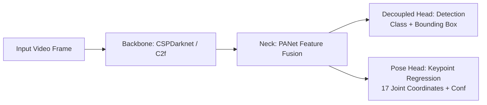
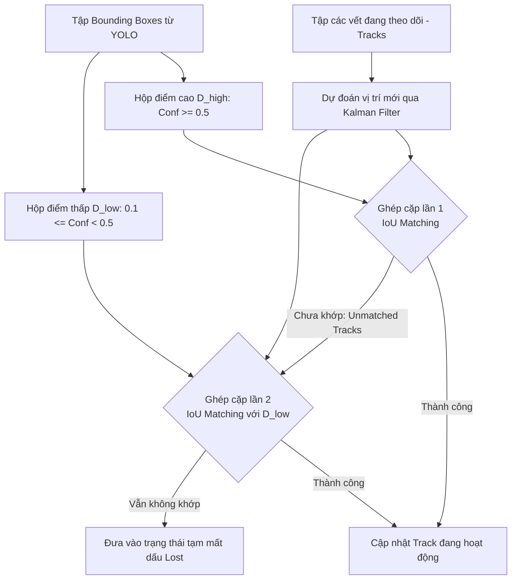
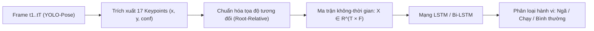

# CHƯƠNG 2: CƠ SỞ LÝ THUYẾT VÀ CÔNG NGHỆ ÁP DỤNG

---

## 2.1. Kiến trúc mạng tích chập phát hiện đối tượng và tư thế thời gian thực (YOLO Architecture & Pose Estimation)

### 2.1.1. Tổng quan dòng kiến trúc YOLO hiện đại (YOLOv8 / YOLOv11)
YOLO (You Only Look Once) là dòng mạng nơ-ron tích chập (CNN) tiên phong trong bài toán phát hiện đối tượng theo cơ chế **One-Stage Detector** (dự đoán trực tiếp vị trí và lớp đối tượng chỉ qua một lần lan truyền tiến). Trong đề tài này, kiến trúc hiện đại từ họ Ultralytics (tiêu biểu là YOLOv8/YOLOv11) được lựa chọn nhờ sự cân bằng tối ưu giữa độ chính xác và tốc độ xử lý thời gian thực.

Mạng gồm 3 khối thành phần chính:
1. **Backbone (Khối trích xuất đặc trưng):** Sử dụng các khối cải tiến từ CSPDarknet (như module C2f / C3k2) kết hợp tích chập sâu và tích chập dư (residual connections). Nhiệm vụ là trích xuất các bản đồ đặc trưng (feature maps) đa tầng từ cấp thấp (đường nét, góc cạnh) đến cấp cao (hình thái cơ thể, ngữ nghĩa).
2. **Neck (Khối tổng hợp đặc trưng):** Áp dụng kiến trúc PANet (Path Aggregation Network) hoặc FPN kết hợp luồng thông tin từ trên xuống (top-down) và từ dưới lên (bottom-up), giúp dung hợp thông tin ngữ nghĩa mạnh ở tầng sâu với thông tin tọa độ chuẩn xác ở tầng nông.
3. **Head (Khối đầu ra đa nhiệm - Decoupled Head):**
   - Khác với các phiên bản cũ gộp chung phân loại và định vị, các kiến trúc YOLO hiện đại tách độc lập nhánh phân loại (Classification Branch) và nhánh hồi quy tọa độ (Bounding Box Regression Branch).
   - Thiết kế **Anchor-free:** Loại bỏ khái niệm khung neo (anchor boxes) truyền thống, dự đoán trực tiếp độ lệch (offsets) từ tâm ô lưới đến 4 cạnh của vật thể, giúp giảm độ phức tạp khi huấn luyện và thích ứng linh hoạt với nhiều kích thước đối tượng khác nhau.



### 2.1.2. Mô hình ước lượng dáng điệu người (Pose Estimation với YOLO-Pose)
Để nhận diện chính xác các hành vi phức tạp như **Ngã (Falling)** và **Chạy (Running)**, hệ thống mở rộng mạng YOLO cơ sở sang biến thể **YOLO-Pose**:
- **Đầu ra Keypoints:** Bên cạnh việc dự đoán Bounding Box, Pose Head dự đoán thêm tập hợp **17 điểm khớp xương cơ thể** theo chuẩn tập dữ liệu MS COCO:
  $$\mathcal{K} = \{(x_k, y_k, c_k)\}_{k=1}^{17}$$
  Trong đó $(x_k, y_k)$ là tọa độ điểm khớp trên mặt phẳng ảnh và $c_k \in [0, 1]$ là điểm tin cậy xác suất điểm khớp đó có thực sự hiện diện và nhìn thấy được hay không.
- **17 điểm mốc cơ bản:**
  - Vùng đầu: Mũi (0), Mắt trái (1), Mắt phải (2), Tai trái (3), Tai phải (4).
  - Vùng thân trên: Vai trái (5), Vai phải (6), Khuỷu tay trái (7), Khuỷu tay phải (8), Cổ tay trái (9), Cổ tay phải (10).
  - Vùng thân dưới: Hông trái (11), Hông phải (12), Đầu gối trái (13), Đầu gối phải (14), Cổ chân trái (15), Cổ chân phải (16).
- **Hàm mất mát ước lượng điểm khớp (OKS Loss - Object Keypoint Similarity):**
  $$\text{OKS} = \frac{\sum_{k} \exp\left(-\frac{d_k^2}{2 s^2 \sigma_k^2}\right) \delta(v_k > 0)}{\sum_{k} \delta(v_k > 0)}$$
  Trong đó $d_k$ là khoảng cách Euclid giữa điểm dự đoán và nhãn thực tế, $s$ là diện tích bao của đối tượng, và $\sigma_k$ là hằng số kiểm soát độ nhạy sai lệch của từng khớp tương ứng.

---

## 2.2. Thuật toán bám vết đa đối tượng (Multi-Object Tracking với ByteTrack)

### 2.2.1. Vai trò của Tracking trong bài toán trinh sát
Mô hình phát hiện đối tượng (Object Detection) chỉ xử lý độc lập từng khung hình mà không có sự liên kết thời gian. Để phát hiện được các hành vi diễn ra theo chuỗi thời gian như **Lảng vảng (đo thời gian tồn tại)** hay **Chạy (đo vận tốc qua các frame)**, hệ thống bắt buộc phải sử dụng thuật toán **Bám vết đa đối tượng (Multi-Object Tracking - MOT)** nhằm duy trì một mã định danh duy nhất (`Track ID`) cho mỗi cá nhân xuyên suốt video.

### 2.2.2. Bộ lọc Kalman (Kalman Filter)
ByteTrack sử dụng mô hình chuyển động tuyến tính dựa trên bộ lọc Kalman để ước lượng và dự báo trạng thái không gian của từng đối tượng:
- **Vector trạng thái 8 chiều:**
  $$\mathbf{x} = [u, v, s, r, \dot{u}, \dot{v}, \dot{s}, \dot{r}]^T$$
  Trong đó $(u, v)$ là tọa độ tâm của bounding box, $s$ là tỷ lệ diện tích ($w \times h$), $r$ là tỷ lệ khung hình ($w / h$), và các biến có dấu chấm đại diện cho vận tốc biến thiên tương ứng.
- **Hai pha hoạt động liên tục:**
  1. *Pha dự đoán (Predict):* Dựa vào phương trình động học để dự báo vị trí mới của đối tượng ở khung hình hiện tại trước khi có kết quả phát hiện mới.
  2. *Pha cập nhật (Update):* Kết hợp vị trí dự đoán với bounding box thực tế vừa nhận diện được từ YOLO để tối ưu hóa và hiệu chỉnh trạng thái bám vết.

### 2.2.3. Cơ chế kết hợp ByteTrack (Association with Low-Score Boxes)
Điểm đột phá của ByteTrack so với các thuật toán truyền thống (như SORT hay DeepSORT) là **không vứt bỏ các bounding box có điểm tin cậy thấp**:
- Khi đối tượng bị che khuất một phần (occlusion), bị nhòe mờ do chuyển động nhanh (motion blur) hoặc ánh sáng yếu, điểm tin cậy detection thường bị tụt xuống dưới ngưỡng thông thường (ví dụ: rơi vào khoảng $0.1 - 0.5$). Các thuật toán cũ lập tức loại bỏ các box này, dẫn đến đứt chuỗi theo dõi và gán ID mới.
- **Quy trình ghép cặp hai giai đoạn (Two-Stage Association) của ByteTrack:**



1. **Ghép cặp lần 1 (First Association):** Ghép các hộp điểm cao ($\mathcal{D}_{high}$) với các vị trí dự đoán từ Kalman Filter thông qua ma trận chi phí khoảng cách IoU (Intersection over Union) và giải thuật Hungarian.
2. **Ghép cặp lần 2 (Second Association):** Đối với các Track còn sót lại chưa ghép được, ByteTrack tiếp tục đem ghép với tập các hộp điểm thấp ($\mathcal{D}_{low}$). Nếu khớp, Track này vẫn được giữ lại, giải quyết triệt để vấn đề mất dấu khi người bị che khuất hoặc cúi gập người khi ngã.

---

## 2.3. Các phương pháp biểu diễn quỹ đạo chuyển động và phân tích hình học tư thế người

### 2.3.1. Biểu diễn quỹ đạo không gian - thời gian (Spatio-Temporal Trajectory)
Đối với mỗi đối tượng có mã định danh $ID$, quỹ đạo chuyển động được mô hình hóa thành một chuỗi thời gian các điểm tọa độ tiếp xúc mặt đất (Foot-Point Trajectory):
$$\mathcal{T}_{ID} = \left\{ \mathbf{p}_t = (x_{foot}^{(t)}, y_{foot}^{(t)}), \quad t \in [t_{start}, t_{curr}] \right\}$$
Trong đó điểm tiếp đất được chuẩn hóa từ cạnh đáy Bounding Box:
$$x_{foot} = \frac{x_1 + x_2}{2}, \quad y_{foot} = y_2$$

### 2.3.2. Thuật toán kiểm tra điểm trong đa giác (Point-in-Polygon - PiP) cho hành vi Xâm nhập
Để kiểm tra xem một điểm $\mathbf{p} = (x_{foot}, y_{foot})$ có xâm nhập vào khu vực cấm hay không, hệ thống áp dụng thuật toán **Ray Casting (Bắn tia)** hoặc phương pháp số lần cuốn (Winding Number):
- Từ điểm $\mathbf{p}$, phóng một tia song song vô hạn theo trục hoành $X$.
- Đếm số lần tia này cắt các cạnh của đa giác vùng cấm:
  $$\text{IsInside}(\mathbf{p}, \mathcal{P}) = 
  \begin{cases} 
  \text{True (Nằm trong vùng cấm)} & \text{nếu số giao điểm là số lẻ} \\
  \text{False (Nằm ngoài vùng an toàn)} & \text{nếu số giao điểm là số chẵn}
  \end{cases}$$

### 2.3.3. Phân tích thời gian lưu trú và bán kính di chuyển cho hành vi Lảng vảng
Một đối tượng được xếp loại là **Lảng vảng (Loitering)** khi thỏa mãn đồng thời hai điều kiện không gian và thời gian:
1. **Thời gian lưu trú (Dwell Time $\Delta t$):**
   $$\Delta t = t_{curr} - t_{entry} \ge \tau_{loiter} \quad (\text{ví dụ: } \tau_{loiter} = 10 \text{ giây})$$
2. **Bán kính dịch chuyển giới hạn (Spatial Confinement):**
   Khoảng cách từ vị trí hiện tại so với tâm điểm trung bình của toàn bộ quỹ đạo trong quá khứ không vượt quá bán kính ngưỡng $R_{threshold}$:
   $$\|\mathbf{p}_t - \bar{\mathbf{p}}\| \le R_{threshold}, \quad \text{với } \bar{\mathbf{p}} = \frac{1}{N}\sum_{i=1}^N \mathbf{p}_i$$
   *(Điều kiện này giúp loại bỏ trường hợp người chỉ đi ngang qua vùng giám sát).*

### 2.3.4. Phân tích hình học tư thế và động học cho hành vi Chạy và Ngã

#### A. Phân tích động học hành vi Chạy (Running Kinematics)
Để triệt tiêu ảnh hưởng của biến dạng phối cảnh (Perspective Distortion), vận tốc tức thời của đối tượng trong cửa sổ trượt $W = [t - k, t]$ được chuẩn hóa theo chiều cao khung bao $H$:
$$V_{norm}(t) = \frac{\|\mathbf{p}_t - \mathbf{p}_{t-k}\|}{k \cdot \Delta t \cdot H_t} \quad (\text{đơn vị: Body Heights / second - } BH/s)$$
- Điều kiện kích hoạt:
  $$V_{norm}(t) > V_{threshold} \quad (\text{với } V_{threshold} \approx 1.5 - 2.0 \, BH/s)$$

#### B. Phân tích hình học bộ xương cho hành vi Ngã (Fall Detection Geometry)
Hành vi ngã được xác định thông qua sự kết hợp của 3 chỉ số hình thái:

```text
         ĐỨNG THẲNG                              NGÃ NẰM NGANG
            Vai                                  Hông --------- Vai
             |                                    |              |
             |  Trục thân: θ ≈ 80° - 90°          +--------------+  Trục thân: θ < 30° - 45°
             |                                    (Mặt đất)
            Hông
```

1. **Góc nghiêng trục thân người (Torso Lean Angle $\theta$):**
   > [!NOTE]
   > **Quy ước thống nhất:** $\theta$ là góc nghiêng của trục thân người so với phương ngang (trục hoành $Ox$ của mặt phẳng ảnh).
   
   Xác định bởi vector nối giữa trung điểm hai vai $\mathbf{p}_{shoulder}$ và trung điểm hai hông $\mathbf{p}_{hip}$:
   $$\theta = \arctan\left(\frac{|y_{hip} - y_{shoulder}|}{|x_{hip} - x_{shoulder}|}\right) \times \frac{180^\circ}{\pi}$$
   - Trạng thái đứng/đi: $\theta \in [70^\circ, 90^\circ]$ (trục thân dựng đứng gần như vuông góc với phương ngang mặt đất).
   - Trạng thái ngã: $\theta$ giảm đột ngột xuống $< 30^\circ - 45^\circ$ (trục thân nằm ngang song song mặt đất).

2. **Tỷ lệ co giãn khung bao (Bounding Box Aspect Ratio - $AR$):**
   $$AR = \frac{\text{Height}}{\text{Width}} = \frac{H}{W}$$
   - Khi đứng: $AR \ge 1.5$ (chiều cao vượt trội chiều rộng).
   - Khi ngã xuống mặt sàn: $AR \le 0.8$ (chiều rộng trải dài hơn chiều cao).

3. **Vận tốc rơi thẳng đứng của trọng tâm (Vertical Drop Velocity):**
   $$V_y = \frac{y_{hip}^{(t)} - y_{hip}^{(t-\Delta t)}}{\Delta t \cdot H_t}$$
   Cú ngã luôn đi kèm một pha gia tốc rơi tự do tức thời ($V_y$ có độ lớn dương lớn đột biến theo phương hướng xuống đất), giúp phân biệt hành vi ngã bất ngờ với việc chủ động nằm/ngồi xuống sàn từ tốn.

---

## 2.4. Mô hình học sâu chuỗi thời gian nhận diện hành động (Temporal Deep Learning for Skeleton-based Action Recognition)

Bên cạnh các quy tắc hình học heuristic (Rule-based) ở mục 2.3, để hệ thống đạt độ chính xác cao trong các kịch bản phức tạp (tránh nhầm lẫn giữa ngã thật với việc cúi nhặt đồ, ngồi xổm, hoặc tập thể dục), kiến trúc học sâu phân loại chuỗi thời gian dựa trên khung xương được tích hợp vào hệ thống.

### 2.4.1. Bài toán nhận diện hành động dựa trên chuỗi khung xương (Skeleton-based Action Recognition)
Thay vì nạp toàn bộ các khung hình video RGB thô (vốn chứa hàng triệu pixel và gây áp lực tính toán cực lớn), mô hình chỉ tiếp nhận tọa độ 17 điểm khớp xương trích xuất từ YOLO-Pose qua thời gian:



1. **Chuẩn hóa tọa độ cục bộ (Root-relative Normalization):**
   Để triệt tiêu ảnh hưởng của vị trí đối tượng trên khung hình (đứng ở góc trái hay góc phải màn hình), tọa độ của các khớp được chuẩn hóa tương đối so với điểm gốc (Root Joint - lấy trung điểm của hai khớp hông $\mathbf{p}_{root} = \frac{\mathbf{p}_{hip\_left} + \mathbf{p}_{hip\_right}}{2}$) và co giãn theo chiều cao khung bao $H$:
   $$x'_k = \frac{x_k - x_{root}}{H}, \quad y'_k = \frac{y_k - y_{root}}{H}, \quad k \in [1, 17]$$
2. **Biểu diễn ma trận chuỗi thời gian:**
   - Tại mỗi thời điểm $t$, vector đặc trưng tư thế $\mathbf{f}_t \in \mathbb{R}^F$ được cấu thành từ 17 cặp tọa độ đã chuẩn hóa (và có thể kèm theo điểm tin cậy $c_k$), với số chiều $F = 17 \times 2 = 34$ (hoặc $F = 17 \times 3 = 51$).
   - Trong một cửa sổ trượt thời gian gồm $T = 30 \text{ frames}$ liên tiếp (tương đương $\approx 1$ giây ở tốc độ 30 FPS), chuỗi hành động được biểu diễn thành ma trận dữ liệu hai chiều:
     $$\mathbf{X} = [\mathbf{f}_1, \mathbf{f}_2, \dots, \mathbf{f}_T]^T \in \mathbb{R}^{T \times F}$$
   - *Ưu điểm:* Kích thước dữ liệu đầu vào cực kỳ nhỏ gọn ($30 \times 34 = 1.020$ giá trị số thực, nhẹ hơn hàng nghìn lần so với một khung hình ảnh RGB), hoàn toàn miễn nhiễm với biến đổi ánh sáng, màu sắc trang phục và nhiễu cảnh nền.

### 2.4.2. Kiến trúc mạng Bộ nhớ ngắn-dài hạn (LSTM / Bi-LSTM) trong phân loại hành vi
Để nắm bắt sự biến thiên động học của tư thế qua chuỗi thời gian $T$, mạng nơ-ron hồi quy có cổng kiểm soát (Long Short-Term Memory - LSTM) được lựa chọn nhằm giải quyết hiện tượng triệt tiêu đạo hàm (Vanishing Gradient) của RNN truyền thống.

#### Cấu trúc tế bào LSTM (LSTM Cell)
Tại mỗi bước thời gian $t$, tế bào LSTM duy trì một trạng thái tế bào (Cell State $C_t$ - đóng vai trò như băng chuyền lưu trữ trí nhớ dài hạn) và một trạng thái ẩn (Hidden State $h_t$ - trí nhớ ngắn hạn), được điều phối qua 3 cổng:

1. **Cổng quên (Forget Gate - $f_t$):** Quyết định lượng thông tin nào từ quá khứ ($C_{t-1}$) cần bị loại bỏ:
   $$f_t = \sigma\left(\mathbf{W}_f \cdot [h_{t-1}, \mathbf{f}_t] + b_f\right)$$
   *(Ví dụ: Khi đối tượng bắt đầu mất thăng bằng rơi tự do, cổng quên sẽ loại bỏ dần ký ức về tư thế đứng thẳng ổn định trước đó).*
2. **Cổng đầu vào (Input Gate - $i_t$ & $\tilde{C}_t$):** Chọn lọc những thông tin tư thế mới nào từ khung hình hiện tại sẽ được nạp vào trí nhớ dài hạn:
   $$i_t = \sigma\left(\mathbf{W}_i \cdot [h_{t-1}, \mathbf{f}_t] + b_i\right)$$
   $$\tilde{C}_t = \tanh\left(\mathbf{W}_c \cdot [h_{t-1}, \mathbf{f}_t] + b_c\right)$$
3. **Cập nhật trạng thái tế bào (Cell State Update - $C_t$):**
   $$C_t = f_t \odot C_{t-1} + i_t \odot \tilde{C}_t$$
4. **Cổng đầu ra (Output Gate - $o_t$ & $h_t$):** Trích xuất thông tin đặc trưng của hành động tại thời điểm hiện tại:
   $$o_t = \sigma\left(\mathbf{W}_o \cdot [h_{t-1}, \mathbf{f}_t] + b_o\right)$$
   $$h_t = o_t \odot \tanh(C_t)$$

#### Phân biệt ngữ cảnh hành động: Ngã thật vs. Hành động sinh hoạt thường nhật
Khả năng ghi nhớ ngữ cảnh theo chuỗi thời gian của LSTM giúp hệ thống phân biệt rõ ràng:
- **Hành vi Ngã (Fall):** Đặc trưng bởi một chuỗi gồm 3 giai đoạn diễn ra liên tục và đột ngột: *(1) Pha đứng bình thường $\rightarrow$ (2) Pha sụp đổ trọng tâm nhanh mất kiểm soát (chỉ trong 5-10 frames) $\rightarrow$ (3) Pha nằm im bất động trên sàn*.
- **Hành vi Ngồi xổm / Cúi người (Squatting / Bending):** Trọng tâm hạ thấp nhưng có chủ đích, gia tốc chuyển động mượt mà, hai bàn chân vẫn giữ nguyên vị trí bám sàn và thân người không nằm bẹp xuống đất.
- **Hành vi Từ từ nằm nghỉ:** Không có pha gia tốc rơi tự do tức thời.

Đầu ra của bước thời gian cuối cùng ($h_T$) được đưa qua một lớp nơ-ron kết nối đầy đủ (Dense Layer) kết hợp hàm kích hoạt Softmax để dự đoán xác suất hành vi:
$$\hat{y} = \text{Softmax}(\mathbf{W}_{out} \cdot h_T + b_{out})$$
Mô hình tự huấn luyện (Self-trained / Fine-tuned) này giúp hệ thống đạt độ nhạy cao và giảm thiểu tối đa các cảnh báo giả trong môi trường giám sát thực tế.
