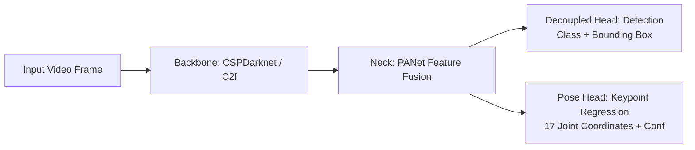
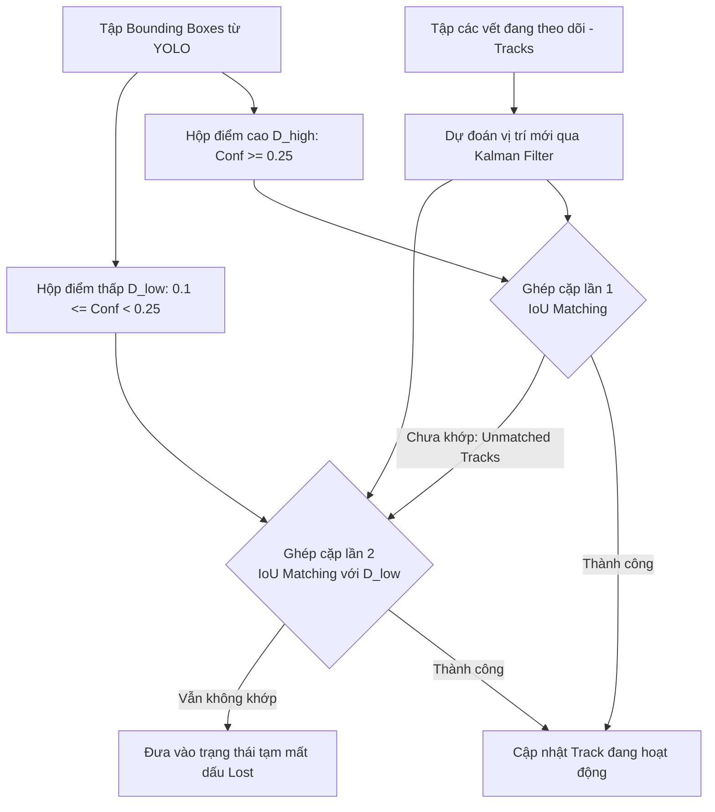
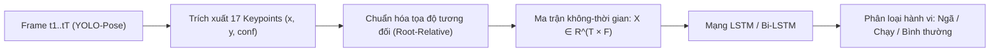

# CHƯƠNG 2: CƠ SỞ LÝ THUYẾT VÀ CÔNG NGHỆ ÁP DỤNG

---

## 2.1. Kiến trúc mạng tích chập phát hiện đối tượng và tư thế thời gian thực (YOLO Architecture & Pose Estimation)

### 2.1.1. Tổng quan dòng kiến trúc YOLO hiện đại (YOLOv8 / YOLOv11)
YOLO (You Only Look Once) là dòng mạng nơ-ron tích chập (CNN) tiên phong trong bài toán phát hiện đối tượng theo cơ chế **One-Stage Detector** (dự đoán trực tiếp vị trí và lớp đối tượng chỉ qua một lần lan truyền tiến). Trong đề tài này, kiến trúc hiện đại từ họ Ultralytics (tiêu biểu là YOLOv8/YOLOv11) được lựa chọn nhờ sự cân bằng tối ưu giữa độ chính xác và tốc độ xử lý thời gian thực.

Mạng gồm 3 khối thành phần chính:
1. **Backbone (Khối trích xuất đặc trưng):** Sử dụng các khối cải tiến từ CSPDarknet (như module C2f / C3k2) kết hợp tích chập sâu và tích chập dư (residual connections). Nhiệm vụ là trích xuất các bản đồ đặc trưng (feature maps) đa tầng từ cấp thấp (đường nét, góc cạnh) đến cấp cao (hình thái cơ thể, ngữ nghĩa).
2. **Neck (Khối tổng hợp đặc trưng):** Áp dụng kiến trúc PANet (Path Aggregation Network) hoặc FPN kết hợp luồng thông tin từ trên xuống (top-down) và từ dưới lên (bottom-up), giúp dung hợp thông tin ngữ nghĩa mạnh ở tầng sâu với thông tin tọa độ chuẩn xác ở tầng nông.
3. **Head (Khối đầu ra đa nhiệm - Decoupled Head):**
   - Khác với các phiên bản cũ gộp chung phân loại và định vị, các kiến trúc YOLO hiện đại tách độc lập nhánh phân loại (Classification Branch) và nhánh hồi quy tọa độ (Bounding Box Regression Branch).
   - Thiết kế **Anchor-free:** Loại bỏ khái niệm khung neo (anchor boxes) truyền thống, dự đoán trực tiếp độ lệch (offsets) từ tâm ô lưới đến 4 cạnh của vật thể, giúp giảm độ phức tạp khi huấn luyện và thích ứng linh hoạt với nhiều kích thước đối tượng khác nhau.



### 2.1.2. Mô hình ước lượng dáng điệu người (Pose Estimation với YOLO-Pose)
Để nhận diện chính xác các hành vi phức tạp như **Ngã (Falling)** và **Chạy (Running)**, hệ thống mở rộng mạng YOLO cơ sở sang biến thể **YOLO-Pose**:
- **Đầu ra Keypoints:** Bên cạnh việc dự đoán Bounding Box, Pose Head dự đoán thêm tập hợp **17 điểm khớp xương cơ thể** theo chuẩn tập dữ liệu MS COCO:
  $$\mathcal{K} = \{(x_k, y_k, c_k)\}_{k=1}^{17}$$
  Trong đó $(x_k, y_k)$ là tọa độ điểm khớp trên mặt phẳng ảnh và $c_k \in [0, 1]$ là điểm tin cậy xác suất điểm khớp đó có thực sự hiện diện và nhìn thấy được hay không.
- **17 điểm mốc cơ bản:**
  - Vùng đầu: Mũi (0), Mắt trái (1), Mắt phải (2), Tai trái (3), Tai phải (4).
  - Vùng thân trên: Vai trái (5), Vai phải (6), Khuỷu tay trái (7), Khuỷu tay phải (8), Cổ tay trái (9), Cổ tay phải (10).
  - Vùng thân dưới: Hông trái (11), Hông phải (12), Đầu gối trái (13), Đầu gối phải (14), Cổ chân trái (15), Cổ chân phải (16).
- **Hàm mất mát ước lượng điểm khớp (OKS Loss - Object Keypoint Similarity):**
  $$\text{OKS} = \frac{\sum_{k} \exp\left(-\frac{d_k^2}{2 s^2 \sigma_k^2}\right) \delta(v_k > 0)}{\sum_{k} \delta(v_k > 0)}$$
  Trong đó $d_k$ là khoảng cách Euclid giữa điểm dự đoán và nhãn thực tế, $s$ là diện tích bao của đối tượng, và $\sigma_k$ là hằng số kiểm soát độ nhạy sai lệch của từng khớp tương ứng.

---

## 2.2. Thuật toán bám vết đa đối tượng (Multi-Object Tracking với ByteTrack)

### 2.2.1. Vai trò của Tracking trong bài toán giám sát
Mô hình phát hiện đối tượng (Object Detection) chỉ xử lý độc lập từng khung hình mà không có sự liên kết thời gian. Để phát hiện được các hành vi diễn ra theo chuỗi thời gian như **Chạy nhanh (đo vận tốc qua các khung hình)**, **Té ngã (hạ người rồi nằm lại)** hay **Đánh nhau (theo dõi từng cặp người)**, hệ thống bắt buộc phải sử dụng thuật toán **Bám vết đa đối tượng (Multi-Object Tracking - MOT)** nhằm duy trì một mã định danh duy nhất (`Track ID`) cho mỗi cá nhân xuyên suốt video.

### 2.2.2. Bộ lọc Kalman (Kalman Filter)
ByteTrack sử dụng mô hình chuyển động tuyến tính dựa trên bộ lọc Kalman để ước lượng và dự báo trạng thái không gian của từng đối tượng:
- **Vector trạng thái 8 chiều:**
  $$\mathbf{x} = [x, y, a, h, \dot{x}, \dot{y}, \dot{a}, \dot{h}]^T$$
  Trong đó $(x, y)$ là tọa độ tâm bounding box, $a = w / h$ là tỷ lệ khung hình, $h$ là chiều cao, và các biến có dấu chấm là vận tốc biến thiên tương ứng (bộ lọc `KalmanFilterXYAH` trong thư viện Ultralytics).
- **Hai pha hoạt động liên tục:**
  1. *Pha dự đoán (Predict):* Dựa vào phương trình động học để dự báo vị trí mới của đối tượng ở khung hình hiện tại trước khi có kết quả phát hiện mới.
  2. *Pha cập nhật (Update):* Kết hợp vị trí dự đoán với bounding box thực tế vừa nhận diện được từ YOLO để tối ưu hóa và hiệu chỉnh trạng thái bám vết.

### 2.2.3. Cơ chế kết hợp ByteTrack (Association with Low-Score Boxes)
Điểm đột phá của ByteTrack so với các thuật toán truyền thống (như SORT hay DeepSORT) là **không vứt bỏ các bounding box có điểm tin cậy thấp**:
- Khi đối tượng bị che khuất một phần (occlusion), bị nhòe mờ do chuyển động nhanh (motion blur) hoặc ánh sáng yếu, điểm tin cậy detection thường bị tụt xuống dưới ngưỡng thông thường (ví dụ: rơi vào khoảng $0.1 - 0.25$). Các thuật toán cũ lập tức loại bỏ các box này, dẫn đến đứt chuỗi theo dõi và gán ID mới.
- **Quy trình ghép cặp hai giai đoạn (Two-Stage Association) của ByteTrack:**



1. **Ghép cặp lần 1 (First Association):** Ghép các hộp điểm cao ($\mathcal{D}_{high}$) với các vị trí dự đoán từ Kalman Filter thông qua ma trận chi phí khoảng cách IoU (Intersection over Union) và giải thuật Hungarian.
2. **Ghép cặp lần 2 (Second Association):** Đối với các Track còn sót lại chưa ghép được, ByteTrack tiếp tục đem ghép với tập các hộp điểm thấp ($\mathcal{D}_{low}$). Nếu khớp, Track này vẫn được giữ lại, giảm đáng kể việc mất dấu khi người bị che khuất một phần hoặc cúi gập người khi ngã.

> **Ghi chú triển khai:** hệ thống dùng ByteTrack với tham số mặc định của Ultralytics (`track_high_thresh = 0.25`, `track_low_thresh = 0.1`, `track_buffer = 30`, `match_thresh = 0.8`). Ngoài ra pipeline chỉ nhận các phát hiện có độ tin cậy từ `confidence_threshold = 0.4` trở lên (cấu hình trong `configs/config.yaml`), nên trên thực tế nhánh ghép cặp với hộp điểm thấp hiếm khi được dùng tới.

---

## 2.3. Biểu diễn chuyển động và phân tích hình học tư thế người

Mọi đại lượng dưới đây đều được tính trên dữ liệu của từng `track_id`: chuỗi bounding box, chuỗi 17 khớp xương và **mốc thời gian thực** của từng khung hình. Vì tốc độ khung hình của khâu AI thay đổi theo phần cứng, mọi vận tốc được tính bằng hiệu thời gian thực $\Delta t$ (giây), không giả định FPS cố định.

### 2.3.1. Đơn vị chuẩn hoá: chiều cao cơ thể (Body Height – BH)
Khoảng cách và vận tốc tính bằng pixel không so sánh được giữa người ở gần và người ở xa camera. Hệ thống chia mọi độ dài cho chiều cao bounding box $H$ của chính người đó, thu được đơn vị **BH** (số lần chiều cao cơ thể) và **BH/s** cho vận tốc. Trên các video mẫu của dự án, vận tốc lớn nhất của người đi bộ bình thường phần lớn nằm dưới $1{,}3$ BH/s.

### 2.3.2. Động học hành vi Chạy nhanh

1. **Vận tốc tịnh tiến chuẩn hoá $V_{norm}$.** Trên cửa sổ thời gian $W$ (mặc định $0{,}5$ giây):
   $$V_{norm} = \frac{\|\bar{\mathbf{c}}_{new} - \bar{\mathbf{c}}_{old}\|}{(\bar{t}_{new} - \bar{t}_{old}) \cdot H_{ref}}$$
   Trong đó $\bar{\mathbf{c}}_{new}$, $\bar{\mathbf{c}}_{old}$ là **trung bình tâm bounding box của 3 khung hình** ở hai đầu cửa sổ (lấy trung bình để giảm nhiễu rung của khung), $\bar{t}$ là trung bình mốc thời gian tương ứng, và $H_{ref}$ là **trung vị chiều cao** bounding box trong cửa sổ (trung vị bền hơn trung bình khi khung bị co giãn đột ngột).

2. **Độ đổ người về phía trước (Body Lean).** Từ góc trục thân $\theta$ (mục 2.3.3), độ đổ người là $90^\circ - \theta$. Khi chạy, thân người thường nghiêng về hướng di chuyển.

3. **Điều kiện nghi vấn chạy tại một thời điểm:**
   $$V_{norm} \ge V_{th} \;\wedge\; \big(\text{Lean} \ge \text{Lean}_{min} \;\vee\; V_{norm} \ge 1{,}5 \cdot V_{th}\big)$$
   với $V_{th} = 1{,}5$ BH/s và $\text{Lean}_{min} = 15^\circ$. Vế thứ hai cho phép bỏ qua điều kiện đổ người khi vận tốc đã rất cao (ví dụ khi khớp vai/hông bị che).

4. **Xác nhận theo thời gian.** Chỉ báo chạy khi điều kiện trên đúng trong `confirm_frames` lần đo liên tiếp (mặc định 3), để loại các đột biến một khung hình do nhiễu bám vết.

> **Giới hạn:** $V_{norm}$ đo dịch chuyển trong mặt phẳng ảnh. Người chạy dọc theo trục nhìn của camera gần như không dịch chuyển trong ảnh nên có thể bị bỏ sót. Tín hiệu bổ sung như tần suất bước chân từ khớp gối/cổ chân chưa được cài đặt.

### 2.3.3. Hình học tư thế cho hành vi Té ngã

```text
         ĐỨNG THẲNG                              NGÃ NẰM NGANG
            Vai                                  Hông --------- Vai
             |                                    |              |
             |  Trục thân: θ ≈ 80° - 90°          +--------------+  Trục thân: θ < 40°
             |                                    (Mặt đất)
            Hông
```

1. **Góc trục thân $\theta$** — góc giữa đoạn nối trung điểm hai vai với trung điểm hai hông và phương ngang của ảnh:
   $$\theta = \arctan\left(\frac{|y_{hip} - y_{shoulder}|}{|x_{hip} - x_{shoulder}|}\right) \times \frac{180^\circ}{\pi}$$
   Đứng/đi: $\theta \approx 70^\circ - 90^\circ$. Nằm ngang: $\theta \le 40^\circ$. Khớp chỉ được dùng khi độ tin cậy $\ge 0{,}3$; nếu chỉ thấy một bên vai/hông thì dùng bên đó.

2. **Tỷ lệ khung bao $AR$:**
   $$AR = \frac{H}{W}$$
   Đứng: $AR \ge 1{,}3$. Nằm trên sàn: $AR \le 0{,}8$.

3. **Chiều cao đứng tham chiếu $H_{ref}$.** Trung vị chiều cao bounding box trong $1{,}5$ giây gần nhất **khi người đang đứng** ($AR > 1{,}3$). Giá trị này bị đóng băng ngay khi có nghi vấn ngã, để các phép đo sau đó luôn so với chiều cao lúc còn đứng.

4. **Tỷ lệ chiều cao hiện tại:** $r = H / H_{ref}$. Người nằm hoặc sụp xuống có $r \le 0{,}55$.

5. **Vận tốc rơi của trọng tâm** trên cửa sổ $0{,}2$ giây:
   $$V_y = \frac{y_{hip}^{(t)} - y_{hip}^{(t - \Delta t)}}{\Delta t \cdot H_{ref}}$$
   Nếu khớp hông không hợp lệ ở một trong hai đầu cửa sổ thì dùng tâm bounding box thay thế (không trộn hông với tâm khung giữa hai đầu). Tương tự, **vận tốc hạ đỉnh khung** $V_{top}$ đo tốc độ đi xuống của cạnh trên bounding box.

6. **Hai nhóm điều kiện:**
   - *Va chạm (impact):* $V_y \ge 0{,}8$ BH/s, **hoặc** ($r \le 0{,}65$ **và** $V_{top} \ge 1{,}0$ BH/s). Sụt chiều cao đơn thuần không đủ, vì ngồi xổm chậm cũng làm giảm chiều cao.
   - *Tư thế thấp (low):* $AR \le 0{,}8$ **hoặc** $\theta \le 40^\circ$ **hoặc** $r \le 0{,}55$.

   Cách hai nhóm điều kiện này được ghép theo thời gian thành máy trạng thái được trình bày ở mục 3.3.

### 2.3.4. Đặc trưng theo cặp người cho hành vi Đánh nhau

Với mỗi cặp người $(A, B)$ cùng xuất hiện trong khung hình:

1. **Khoảng cách chuẩn hoá:** $D_{norm} = \dfrac{\|\mathbf{c}_A - \mathbf{c}_B\|}{(H_A + H_B)/2}$, với $\mathbf{c}$ là tâm bounding box.

2. **Độ chồng lấn** $IoU(A, B)$ giữa hai bounding box.

3. **Lọc chênh lệch phối cảnh.** Nếu cả hai đều đang đứng ($AR > 1{,}2$) mà $\max(H_A, H_B) / \min(H_A, H_B) > 2$, hai người thực ra ở hai độ sâu khác nhau (tiền cảnh – hậu cảnh) và chỉ chồng lên nhau trong ảnh 2D; cặp này bị loại.

4. **Vận tốc tứ chi tương đối $V_{limb}$.** Với các khớp khuỷu tay, cổ tay, cổ chân, lấy vị trí **tương đối so với tâm thân** (trung bình hai vai và hai hông), rồi đo tốc độ thay đổi của vị trí tương đối này qua 3 khung hình, chia cho chiều cao cơ thể:
   $$V_{limb} = \max_{k \in \text{khớp tứ chi}} \frac{\|(\mathbf{p}_k^{(t)} - \mathbf{c}_{torso}^{(t)}) - (\mathbf{p}_k^{(t')} - \mathbf{c}_{torso}^{(t')})\|}{(t - t') \cdot H}$$
   Trừ đi chuyển động của thân giúp phân biệt "vung tay ra đòn" với "cả người đang di chuyển".

5. **Độ giật lắc của thân $A_{torso}$:** vận tốc tâm bounding box qua 2 khung hình, tính bằng BH/s. Dùng khi hai người ôm vật nhau và cổ tay bị che khuất.

6. **Vận tốc áp sát $V_{close}$:** tốc độ giảm của $D_{norm}$ theo thời gian.

7. **Vùng trúng đòn.** Một khớp tay (khuỷu/cổ tay) của người này nằm cách các điểm đầu của người kia dưới $0{,}28$ BH, hoặc nằm trong bounding box (nới thêm $0{,}22$ BH) của người kia; hoặc khớp cổ chân nằm trong bounding box của người kia ở trên mức bàn chân (đá).

Ba dấu hiệu được định nghĩa từ các đại lượng trên — *ra đòn*, *vật lộn*, *lao vào nhau* — được trình bày ở mục 3.5.

---

## 2.4. Mô hình học sâu chuỗi thời gian nhận diện hành động (Temporal Deep Learning for Skeleton-based Action Recognition)

Bên cạnh các quy tắc hình học heuristic (Rule-based) ở mục 2.3, để hệ thống đạt độ chính xác cao trong các kịch bản phức tạp (tránh nhầm lẫn giữa ngã thật với việc cúi nhặt đồ, ngồi xổm, hoặc tập thể dục), kiến trúc học sâu phân loại chuỗi thời gian dựa trên khung xương được thiết kế làm tầng xác minh thứ hai.

> **Trạng thái thực hiện:** kiến trúc mạng, script trích xuất dữ liệu và script huấn luyện đã có trong mã nguồn, nhưng **mô hình chưa được huấn luyện bằng dữ liệu thật** và tầng xác minh này đang tắt (`enable_bilstm_tier2: false`). Mục này trình bày cơ sở lý thuyết của thiết kế.

### 2.4.1. Bài toán nhận diện hành động dựa trên chuỗi khung xương (Skeleton-based Action Recognition)
Thay vì nạp toàn bộ các khung hình video RGB thô (vốn chứa hàng triệu pixel và gây áp lực tính toán cực lớn), mô hình chỉ tiếp nhận tọa độ 17 điểm khớp xương trích xuất từ YOLO-Pose qua thời gian:



1. **Chuẩn hóa tọa độ cục bộ (Root-relative Normalization):**
   Để triệt tiêu ảnh hưởng của vị trí đối tượng trên khung hình (đứng ở góc trái hay góc phải màn hình), tọa độ của các khớp được chuẩn hóa tương đối so với điểm gốc (Root Joint - lấy trung điểm của hai khớp hông $\mathbf{p}_{root} = \frac{\mathbf{p}_{hip\_left} + \mathbf{p}_{hip\_right}}{2}$) và co giãn theo chiều cao khung bao $H$:
   $$x'_k = \frac{x_k - x_{root}}{H}, \quad y'_k = \frac{y_k - y_{root}}{H}, \quad k \in [1, 17]$$
2. **Biểu diễn ma trận chuỗi thời gian:**
   - Tại mỗi thời điểm $t$, vector đặc trưng tư thế $\mathbf{f}_t \in \mathbb{R}^F$ được cấu thành từ 17 cặp tọa độ đã chuẩn hóa (và có thể kèm theo điểm tin cậy $c_k$), với số chiều $F = 17 \times 2 = 34$ (hoặc $F = 17 \times 3 = 51$).
   - Trong một cửa sổ trượt thời gian gồm $T = 30 \text{ frames}$ liên tiếp (tương đương $\approx 1$ giây ở tốc độ 30 FPS), chuỗi hành động được biểu diễn thành ma trận dữ liệu hai chiều:
     $$\mathbf{X} = [\mathbf{f}_1, \mathbf{f}_2, \dots, \mathbf{f}_T]^T \in \mathbb{R}^{T \times F}$$
   - *Ưu điểm:* Kích thước dữ liệu đầu vào cực kỳ nhỏ gọn ($30 \times 34 = 1.020$ giá trị số thực, nhẹ hơn hàng nghìn lần so với một khung hình ảnh RGB), hoàn toàn miễn nhiễm với biến đổi ánh sáng, màu sắc trang phục và nhiễu cảnh nền.

### 2.4.2. Kiến trúc mạng Bộ nhớ ngắn-dài hạn (LSTM / Bi-LSTM) trong phân loại hành vi
Để nắm bắt sự biến thiên động học của tư thế qua chuỗi thời gian $T$, mạng nơ-ron hồi quy có cổng kiểm soát (Long Short-Term Memory - LSTM) được lựa chọn nhằm giải quyết hiện tượng triệt tiêu đạo hàm (Vanishing Gradient) của RNN truyền thống.

#### Cấu trúc tế bào LSTM (LSTM Cell)
Tại mỗi bước thời gian $t$, tế bào LSTM duy trì một trạng thái tế bào (Cell State $C_t$ - đóng vai trò như băng chuyền lưu trữ trí nhớ dài hạn) và một trạng thái ẩn (Hidden State $h_t$ - trí nhớ ngắn hạn), được điều phối qua 3 cổng:

1. **Cổng quên (Forget Gate - $f_t$):** Quyết định lượng thông tin nào từ quá khứ ($C_{t-1}$) cần bị loại bỏ:
   $$f_t = \sigma\left(\mathbf{W}_f \cdot [h_{t-1}, \mathbf{f}_t] + b_f\right)$$
   *(Ví dụ: Khi đối tượng bắt đầu mất thăng bằng rơi tự do, cổng quên sẽ loại bỏ dần ký ức về tư thế đứng thẳng ổn định trước đó).*
2. **Cổng đầu vào (Input Gate - $i_t$ & $\tilde{C}_t$):** Chọn lọc những thông tin tư thế mới nào từ khung hình hiện tại sẽ được nạp vào trí nhớ dài hạn:
   $$i_t = \sigma\left(\mathbf{W}_i \cdot [h_{t-1}, \mathbf{f}_t] + b_i\right)$$
   $$\tilde{C}_t = \tanh\left(\mathbf{W}_c \cdot [h_{t-1}, \mathbf{f}_t] + b_c\right)$$
3. **Cập nhật trạng thái tế bào (Cell State Update - $C_t$):**
   $$C_t = f_t \odot C_{t-1} + i_t \odot \tilde{C}_t$$
4. **Cổng đầu ra (Output Gate - $o_t$ & $h_t$):** Trích xuất thông tin đặc trưng của hành động tại thời điểm hiện tại:
   $$o_t = \sigma\left(\mathbf{W}_o \cdot [h_{t-1}, \mathbf{f}_t] + b_o\right)$$
   $$h_t = o_t \odot \tanh(C_t)$$

#### Phân biệt ngữ cảnh hành động: Ngã thật vs. Hành động sinh hoạt thường nhật
Khả năng ghi nhớ ngữ cảnh theo chuỗi thời gian của LSTM giúp hệ thống phân biệt rõ ràng:
- **Hành vi Ngã (Fall):** Đặc trưng bởi một chuỗi gồm 3 giai đoạn diễn ra liên tục và đột ngột: *(1) Pha đứng bình thường $\rightarrow$ (2) Pha sụp đổ trọng tâm nhanh mất kiểm soát (chỉ trong 5-10 frames) $\rightarrow$ (3) Pha nằm im bất động trên sàn*.
- **Hành vi Ngồi xổm / Cúi người (Squatting / Bending):** Trọng tâm hạ thấp nhưng có chủ đích, gia tốc chuyển động mượt mà, hai bàn chân vẫn giữ nguyên vị trí bám sàn và thân người không nằm bẹp xuống đất.
- **Hành vi Từ từ nằm nghỉ:** Không có pha gia tốc rơi tự do tức thời.

Mạng hai chiều (Bi-LSTM) chạy thêm một LSTM theo chiều ngược thời gian và ghép hai trạng thái ẩn lại, để mỗi thời điểm có ngữ cảnh cả trước lẫn sau. Đầu ra tại bước thời gian cuối cùng ($h_T$) được đưa qua lớp Dropout và một lớp kết nối đầy đủ, rồi qua Softmax để thu xác suất ba lớp (Bình thường, Chạy, Ngã):
$$\hat{y} = \text{Softmax}(\mathbf{W}_{out} \cdot h_T + b_{out})$$
Mức độ cải thiện thực tế của tầng xác minh này chỉ có thể khẳng định sau khi huấn luyện và đánh giá trên dữ liệu có nhãn (xem Chương 4).

> **Lưu ý về cài đặt hiện tại:** mã nguồn lấy đầu ra của Bi-LSTM tại bước thời gian cuối. Ở vị trí đó nhánh ngược chiều mới chỉ đọc một khung hình, nên phần lớn thông tin đến từ nhánh xuôi. Khi huấn luyện lại nên ghép trạng thái ẩn cuối của cả hai chiều hoặc lấy trung bình theo thời gian.
