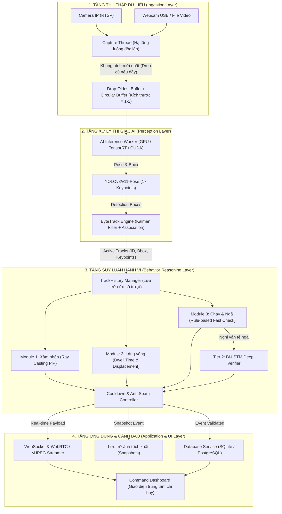
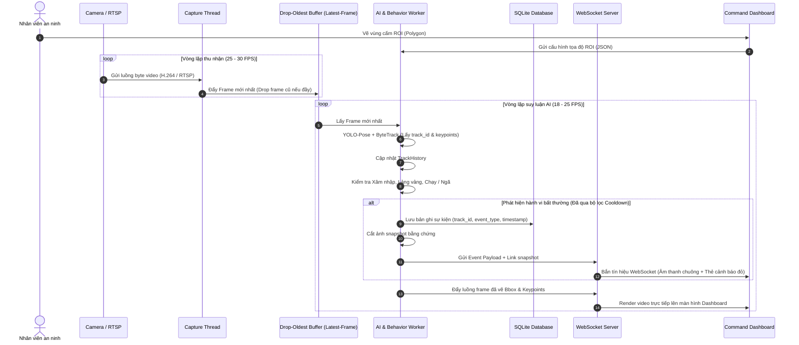
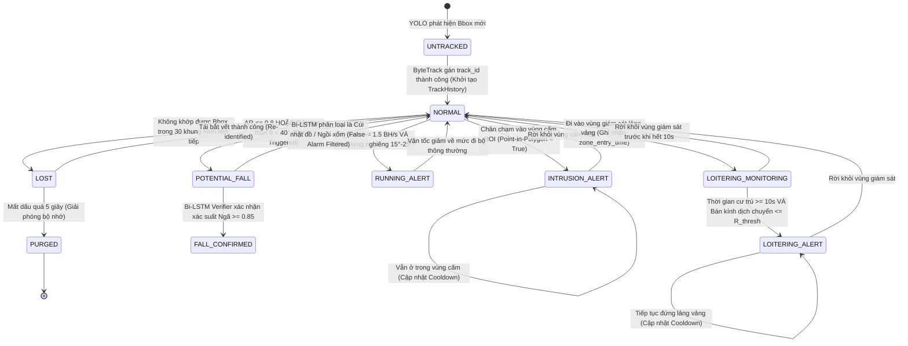
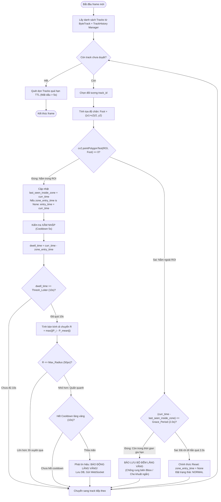
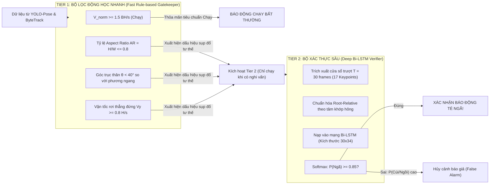
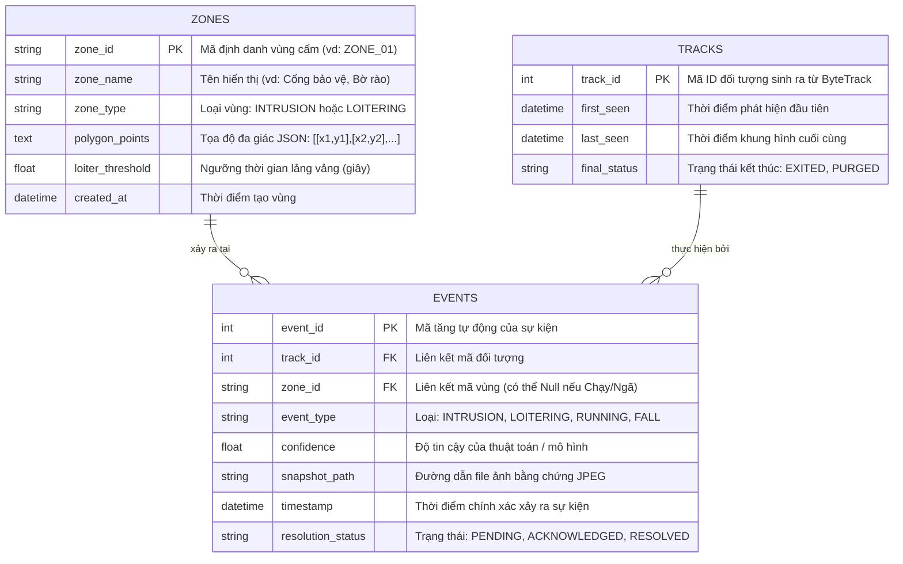

# CHƯƠNG 3: PHÂN TÍCH VÀ THIẾT KẾ HỆ THỐNG

---

## 3.1. Kiến trúc tổng thể hệ thống trinh sát (Pipeline đa luồng)

### 3.1.1. Kiến trúc 4 tầng (4-Layer System Architecture)
Hệ thống được thiết kế theo mô hình phân tầng hướng dịch vụ (Layered Architecture), tách biệt hoàn toàn giữa việc thu thập dữ liệu thô, động cơ suy luận AI, tầng phân tích hành vi nghiệp vụ và tầng giao diện điều khiển:



---

### 3.1.2. Tại sao phải thiết kế Pipeline Đa luồng (Multi-threading)?

Trong các bài hướng dẫn cơ bản, video thường được xử lý tuần tự bằng vòng lặp đơn:
```python
# CÁCH LÀM TRUYỀN THỐNG (ĐƠN LUỒNG) - KHÔNG THỂ DÙNG THỰC TẾ
while True:
    ret, frame = cap.read()       # Bị block bởi I/O mạng hoặc USB
    results = model(frame)        # Tốn 30-50ms (GPU/CPU)
    draw_and_show(results)        # Tốn 10ms
```

**Nhược điểm chí mạng của vòng lặp đơn luồng:**
1. **Tràn bộ đệm RTSP (Buffer Lag):** Luồng RTSP từ Camera IP liên tục đẩy khung hình vào bộ nhớ đệm socket của hệ điều hành với tốc độ $25 - 30 \text{ FPS}$. Nếu khâu xử lý AI mất $50\text{ms}$ ($\approx 20 \text{ FPS}$), bộ đệm mạng sẽ bị tích lũy khung hình trễ. Sau 10 phút, video hiển thị trên màn hình sẽ bị **chậm hơn thực tế từ 10 đến 30 giây**, làm mất hoàn toàn tính trinh sát thời gian thực.
2. **Đóng băng giao diện người dùng (UI Freezing):** Nếu giao diện vẽ bằng OpenCV (`cv2.imshow`) hoặc web dashboard chạy chung luồng AI, mỗi khi mô hình quá tải, giao diện sẽ giật lag, thao tác vẽ vùng cấm ROI bằng chuột sẽ bị khựng.

**Giải pháp Kiến trúc Đa luồng Producer-Consumer:**
- **Luồng 1 - `CaptureThread` (Producer):** Chuyên trách đọc dữ liệu từ RTSP/Webcam với tốc độ tối đa của camera. Sử dụng hàng đợi **Circular Buffer / Drop-Oldest Queue (`maxsize=1-2`)**: nếu AI chưa kịp xử lý xong, frame cũ nhất trong hàng đợi sẽ bị vứt bỏ ngay lập tức để nạp frame mới nhất vào thế chỗ $\rightarrow$ **Độ trễ luôn tiệm cận 0ms (Zero Latency)**.
- **Luồng 2 - `InferenceWorker` (Consumer):** Lấy frame mới nhất từ hàng đợi, nạp vào GPU xử lý YOLO-Pose, ByteTrack và chạy các module phân tích hành vi.
- **Luồng 3 - `BroadcastService`:** Chịu trách nhiệm mã hóa luồng hiển thị và đẩy sự kiện qua WebSocket tới trình duyệt của người giám sát một cách bất đồng bộ (Asynchronous I/O).

---

### 3.1.3. Sơ đồ tuần tự (Sequence Diagram) luồng dữ liệu thời gian thực



---

## 3.2. Thiết kế thuật toán phát hiện xâm nhập và lảng vảng

### 3.2.1. Cấu trúc dữ liệu quản lý vòng đời đối tượng (`TrackHistory`)
Để theo dõi trạng thái di chuyển và thời gian của từng đối tượng, hệ thống quản lý một bảng băm `dict[int, TrackHistory]` trong bộ nhớ RAM:

```python
class TrackHistory:
    track_id: int                    # Mã định danh đối tượng từ ByteTrack
    first_seen: float                # Timestamp thời điểm đối tượng xuất hiện lần đầu (giây)
    last_seen: float                 # Timestamp khung hình gần nhất nhìn thấy đối tượng
    foot_positions: deque            # Hàng đợi lưu N vị trí chân gần nhất: deque(maxlen=30) [(x, y), ...]
    bbox_history: deque              # Hàng đợi lưu N bounding box gần nhất: deque(maxlen=30) [(x1, y1, x2, y2), ...]
    keypoints_history: deque         # Hàng đợi lưu 17 khớp xương: deque(maxlen=30) [ndarray(17, 3), ...]
    current_state: ObjectState       # Trạng thái hiện tại của track_id (NORMAL, LOST, LOITERING,...)
    current_zone_id: Optional[str]   # ID của vùng ROI mà đối tượng đang đứng bên trong (None nếu ở ngoài)
    zone_entry_time: Optional[float] # Thời điểm bắt đầu bước chân vào ROI hiện tại
    last_seen_inside_zone: float     # Timestamp gần nhất đối tượng còn nằm trong ROI (cho bộ lọc Grace Period)
    exit_grace_period: float = 2.0   # Thời gian gia hạn chống rung biên & che khuất (giây)
    last_alert_time: dict[str, float]# Lưu timestamp cảnh báo gần nhất theo loại: {"INTRUSION": t1, "LOITER": t2}
```

---

### 3.2.2. Biểu đồ chuyển đổi trạng thái (State Machine Diagram) của một `track_id`

Mỗi đối tượng đi vào tầm quan sát của camera sẽ trải qua các bước biến đổi trạng thái nghiêm ngặt nhằm tránh việc chuyển trạng thái hỗn loạn:



---

### 3.2.3. Lưu đồ thuật toán và Mã giả phát hiện Xâm nhập & Lảng vảng

#### Lưu đồ thuật toán (Flowchart)


#### Mã giả (Structured Pseudocode với Cơ chế Debounce Grace Period)
```python
EXIT_GRACE_PERIOD = 2.0  # Thời gian gia hạn 2 giây chống rung biên và che khuất
TRACK_TTL = 5.0          # Time-to-Live: xóa track nếu mất dấu quá 5 giây

def process_spatial_temporal_behaviors(tracks, roi_polygons, current_timestamp, track_manager):
    # 1. Cập nhật các track nhìn thấy ở frame hiện tại
    active_track_ids = set()
    for track in tracks:
        track_id = track.id
        active_track_ids.add(track_id)
        
        # Lấy hoặc khởi tạo hồ sơ lưu trữ bền vững (Persistent TrackHistory)
        history = track_manager.get_or_create(track_id, current_timestamp)
        history.last_seen = current_timestamp
        
        x1, y1, x2, y2 = track.tlbr
        foot_point = ((x1 + x2) / 2.0, y2)
        history.foot_positions.append(foot_point)
        
        is_inside_any_zone = False
        for zone in roi_polygons:
            if cv2.pointPolygonTest(zone.polygon_np, foot_point, False) >= 0:
                is_inside_any_zone = True
                history.last_seen_inside_zone = current_timestamp
                
                # Bắt đầu tính giờ vào vùng (nếu trước đó chưa có)
                if history.zone_entry_time is None:
                    history.zone_entry_time = current_timestamp
                
                # --- XỬ LÝ HÀNH VI XÂM NHẬP ---
                if zone.type == "RESTRICTED_INTRUSION":
                    if can_fire_alert(track_id, "INTRUSION", current_timestamp, cooldown=5.0):
                        trigger_alert(event="INTRUSION", track_id=track_id, zone_id=zone.id)
                
                # --- XỬ LÝ HÀNH VI LẢNG VẢNG ---
                if zone.type == "LOITERING_ZONE":
                    dwell_time = current_timestamp - history.zone_entry_time
                    if dwell_time >= zone.loiter_threshold:
                        if compute_trajectory_displacement(history.foot_positions) <= zone.radius_limit:
                            if can_fire_alert(track_id, "LOITERING", current_timestamp, cooldown=10.0):
                                trigger_alert(event="LOITERING", track_id=track_id, zone_id=zone.id, duration=dwell_time)
                break
        
        # XỬ LÝ KHI CHÂN TẠM THỜI RA NGOÀI VÙNG ROI (Chống rung lắc biên Bbox)
        if not is_inside_any_zone:
            time_since_exit = current_timestamp - history.last_seen_inside_zone
            # Chỉ reset bộ đếm khi đối tượng thực sự rời đi vượt quá Grace Period (2 giây)
            if time_since_exit > EXIT_GRACE_PERIOD:
                history.zone_entry_time = None
                history.current_zone_id = None

    # 2. Quét dọn bộ nhớ TrackHistory (Garbage Collection / TTL Cleanup)
    for tid, hist in list(track_manager.all_tracks.items()):
        # Nếu track bị ByteTrack đánh dấu LOST quá lâu (vượt quá TTL 5 giây)
        if current_timestamp - hist.last_seen > TRACK_TTL:
            track_manager.delete_track(tid)
```

> [!IMPORTANT]
> **Giải pháp kỹ thuật loại trừ lỗi mất dấu thời gian (Hysteresis & Grace Buffer):**
> 1. **Triệt tiêu rung lắc biên (Boundary Jitter):** Khi đối tượng đứng ngay trên ranh giới vùng cấm, tọa độ Bounding box dao động $\pm 2$ pixel giữa các frame có thể làm điểm chân lúc lọt vào trong, lúc ra ngoài. Nhờ khoảng đệm `EXIT_GRACE_PERIOD = 2.0s`, bộ đếm thời gian lưu trú không bao giờ bị reset oan uổng.
> 2. **Duy trì bộ nhớ khi bị che khuất tạm thời (Lost Track Preservation):** Khi có người đi ngang qua che khuất đối tượng trong $0.5 - 1.5\text{s}$, ByteTrack giữ track ở trạng thái `LOST`. Hồ sơ `TrackHistory` vẫn bảo lưu `zone_entry_time`. Khi đối tượng tái xuất hiện (Re-ID thành công), bộ đếm 9 giây vẫn tiếp tục nhảy lên 10 giây và kích hoạt cảnh báo lảng vảng hoàn toàn chính xác!

---

## 3.3. Thiết kế thuật toán phát hiện chuyển động bất thường và té ngã

Để triệt tiêu cảnh báo giả mà vẫn đảm bảo tốc độ thời gian thực, hệ thống áp dụng kiến trúc phối hợp **2 tầng (Two-Tier Hybrid Architecture)**:



### 3.3.1. Phân tầng logic chi tiết
- **Tier 1 (Fast Gatekeeper - Chạy mỗi frame, tốn $< 0.2\text{ms}$):**
  - Đóng vai trò là "người gác cổng" kiểm tra sơ bộ các đại lượng toán học và hình học thuần túy.
  - Bình thường khi con người đi lại, đứng ngồi tự nhiên, tầng này trả về `False` ngay lập tức. Tầng 2 hoàn toàn **không cần chạy**, tiết kiệm hơn 95% công suất tính toán cho card đồ họa GPU.
- **Tier 2 (Deep Bi-LSTM Verifier - Chỉ chạy khi có kích hoạt từ Tier 1):**
  - Khi đối tượng có cú sụp đổ hình thể đột ngột (thỏa mãn chỉ số $AR \le 0.8$ hoặc $\theta < 40^\circ$), hệ thống lấy dữ liệu 30 frame gần nhất từ `track.keypoints_history`.
  - Mạng Bi-LSTM đánh giá biến thiên của chuỗi chuyển động trong 1 giây qua. Nếu mô hình nhận thấy có giai đoạn *mất kiểm soát gia tốc rơi tự do* trước khi tiếp đất $\rightarrow$ Khẳng định **Ngã thật**. Nếu đối tượng cúi từ từ xuống nhặt chìa khóa rơi hoặc chủ động ngồi bệt $\rightarrow$ Bác bỏ cảnh báo.

### 3.3.2. Thiết kế bộ trích xuất đặc trưng Root-Relative và kiến trúc mạng Bi-LSTM

#### A. Công thức chuẩn hóa Root-Relative
Để mô hình học sâu không bị phụ thuộc vào vị trí của người trên khung hình (đứng ở góc trái hay góc phải camera) cũng như kích thước người do xa/gần, hệ thống chuẩn hóa 17 điểm khớp xương về hệ tọa độ cục bộ gắn với trọng tâm cơ thể:
- **Tọa độ gốc (Root Joint):** Lấy trung điểm giữa khớp hông trái (Keypoint 11) và hông phải (Keypoint 12):
  $$x_{root} = \frac{x_{11} + x_{12}}{2}, \quad y_{root} = \frac{y_{11} + y_{12}}{2}$$
- **Tọa độ chuẩn hóa của từng điểm khớp $k \in [1, 17]$:**
  $$x'_k = \frac{x_k - x_{root}}{H}, \quad y'_k = \frac{y_k - y_{root}}{H}$$
  *(Trong đó $H$ là chiều cao Bounding Box của đối tượng ở frame tương ứng).*
- **Vector đặc trưng mỗi frame:** $\mathbf{f}_t = [x'_1, y'_1, x'_2, y'_2, \dots, x'_{17}, y'_{17}]^T \in \mathbb{R}^{34}$.
- **Ma trận đầu vào cửa sổ trượt $T = 30$ frames:** $\mathbf{X} = [\mathbf{f}_1, \mathbf{f}_2, \dots, \mathbf{f}_{30}]^T \in \mathbb{R}^{30 \times 34}$.

#### B. Bảng cấu trúc mạng nơ-ron tự huấn luyện (Bi-LSTM Verifier Architecture)
Kiến trúc mạng được thiết kế tối ưu, gọn nhẹ để có thể suy luận trực tiếp trên CPU/GPU thời gian thực trong chưa đầy $3\text{ms}$:

| STT | Tầng (Layer) | Loại tầng (Type) | Cấu hình tham số (Configuration) | Kích thước đầu ra (Output Shape) | Vai trò chức năng |
| :---: | :--- | :--- | :--- | :--- | :--- |
| **1** | **InputLayer** | `Input` | $T = 30\text{ frames}, F = 34\text{ features}$ | `(None, 30, 34)` | Tiếp nhận ma trận chuỗi 17 khớp xương chuẩn hóa |
| **2** | **Bi-LSTM** | `Bidirectional(LSTM)` | 64 units mỗi chiều (Forward 64 + Backward 64), `return_sequences=False` | `(None, 128)` | Học ngữ cảnh biến thiên tư thế hai chiều theo trục thời gian |
| **3** | **Regularization** | `Dropout` | `rate = 0.3` | `(None, 128)` | Chống hiện tượng quá khớp (Overfitting) trên dữ liệu thực |
| **4** | **OutputLayer** | `Dense` | 3 units, activation = `'softmax'` | `(None, 3)` | Phân phối xác suất 3 lớp: `[Bình thường, Té ngã, Ngồi/Cúi]` |

> $\rightarrow$ Khi xác suất lớp `Té ngã` vượt ngưỡng tin cậy $P(\text{Fall}) \ge 0.85$, hệ thống mới kích hoạt cảnh báo đỏ; ngược lại nếu $P(\text{Ngồi/Cúi})$ chiếm ưu thế, sự kiện bị hủy bỏ ngay tại tầng suy luận.

---

## 3.4. Thiết kế cơ sở dữ liệu lưu trữ sự kiện và cơ chế cảnh báo

### 3.4.1. Cơ chế Chống Spam Cảnh báo (Cooldown Mechanism)
Nếu một đối tượng đứng lảng vảng trong vùng cấm suốt 1 phút, hệ thống camera chạy 25 FPS sẽ kiểm tra điều kiện $25 \times 60 = 1.500$ lần. Nếu không có bộ kiểm soát cooldown, hệ thống sẽ **bắn ra 1.500 bản ghi cảnh báo**, gây sập cơ sở dữ liệu và làm tràn ngập màn hình nhân viên an ninh.

**Quy tắc Cooldown theo cặp khóa `(track_id, event_type)`:**
- Khi một sự kiện loại $E$ của đối tượng mang mã $ID$ được kích hoạt tại thời điểm $t_{now}$:
  $$\text{CanTrigger} = (t_{now} - \text{last\_alert\_time}[ID][E]) \ge T_{cooldown}(E)$$
- **Bảng ngưỡng thời gian Cooldown đề xuất:**
  - `INTRUSION` (Xâm nhập): $T_{cooldown} = 5.0 \text{ giây}$.
  - `LOITERING` (Lảng vảng): $T_{cooldown} = 10.0 \text{ giây}$.
  - `RUNNING` (Chạy bứt tốc): $T_{cooldown} = 4.0 \text{ giây}$.
  - `FALL` (Té ngã): $T_{cooldown} = 15.0 \text{ giây}$ (để nhân viên kịp xử lý hiện trường, tránh kêu chuông lặp lại liên tục khi người bị ngã vẫn đang nằm bất động).

---

### 3.4.2. Thiết kế Lược đồ Cơ sở dữ liệu (Database Schema)

Hệ thống sử dụng cơ sở dữ liệu quan hệ (SQLite cho bản gọn / PostgreSQL cho triển khai quy mô lớn) gồm 3 bảng chính:



---

### 3.4.3. Thiết kế Giao diện Trung tâm chỉ huy (Command Dashboard Wireframe)

Giao diện Web Dashboard được xây dựng tối ưu cho màn hình Full HD ($1920 \times 1080$), chia thành 3 phân vùng chức năng rõ ràng:

```text
+-------------------------------------------------------------------------------------------------------+
|  LOGO  | HỆ THỐNG TRINH SÁT AN NINH THỜI GIAN THỰC (AI SURVEILLANCE) | Status: ONLINE | FPS: 27.4    |
+-------------------------------------------------------------------------------------------------------+
| [A] KHUNG HIỂN THỊ CAMERA CHÍNH (70% WIDTH)          | [B] CỘT SỰ KIỆN THỜI GIAN THỰC (30% WIDTH)     |
|                                                      | +-------------------------------------------+ |
| +--------------------------------------------------+ | | DANH SÁCH BÁO ĐỘNG MỚI NHẤT (WEBSOCKET)   | |
| | Live Stream: Cam-01 (Kho A - Hàng rào phía Tây)  | | +-------------------------------------------+ |
| |                                                  | | [16:42:15] ⚠️ TÉ NGÃ (FALL DETECTED)         | |
| |        (VÙNG CẤM ĐA GIÁC ĐỎ)                     | | - Đối tượng: Track ID #12                   | |
| |       *-------------------*                      | | - Vị trí: Sảnh tầng 1 - Khu vực cầu thang   | |
| |       |                   |   [Bbox ID: 05]      | | - Độ tin cậy: 92.4% (Tier 2 Verified)       | |
| |       |  (Foot Point)     |     O  [Running]     | | [Ảnh thu nhỏ]  [Xác nhận] [Xem clip cắt]    | |
| |       |       x           |    /|\               | +-------------------------------------------+ |
| |       *-------------------*    / \               | | [16:41:50] 🚫 XÂM NHẬP VÙNG CẤM             | |
| |   [Bbox ID: 03 - Intrusion Alert]                | | - Đối tượng: Track ID #03                   | |
| |                                                  | | - Khu vực: Vùng cấm Kho A                   | |
| +--------------------------------------------------+ | [Ảnh thu nhỏ]  [Xác nhận] [Xem clip cắt]    | |
| CÔNG CỤ VẼ VÙNG:                                     | +-------------------------------------------+ |
| [🖌️ Vẽ vùng ROI mới] [💾 Lưu vùng] [🗑️ Xóa vùng]     | | [16:40:02] ⏳ LẢNG VẢNG BẤT THƯỜNG          | |
| Nguồn camera: [CAM-01 (RTSP) v] [Upload Video File]  | | - Đối tượng: Track ID #01 (Dwell: 14s)      | |
+-------------------------------------------------------------------------------------------------------+
| [C] THANH THỐNG KÊ NHANH & TÌNH TRẠNG HỆ THỐNG                                                       |
| • Số người trong khung hình: 04  | • Tổng số cảnh báo hôm nay: 28 | • Xâm nhập: 12 | • Ngã: 02 | • Chạy: 05 |
+-------------------------------------------------------------------------------------------------------+
```

- **Phân vùng [A] - Khu vực Luồng Camera trực tiếp:**
  - Hiển thị video stream trực tiếp với overlay Bounding Box, Track ID, nhãn hành vi thời gian thực và 17 khớp xương người.
  - Tích hợp công cụ tương tác chuột: Cho phép người vận hành nhấp chuột trực tiếp lên màn hình để định nghĩa các đỉnh của đa giác ROI vùng cấm mà không cần can thiệp vào file cấu hình code.
- **Phân vùng [B] - Cột Sự kiện Thời gian thực (Real-time Event Feed):**
  - Nhận thông điệp cảnh báo đẩy tức thời qua WebSocket.
  - Hiển thị thẻ sự kiện theo màu độ nguy cấp (Đỏ: Ngã/Xâm nhập; Vàng: Lảng vảng; Cam: Chạy).
  - Tích hợp ảnh thu nhỏ (snapshot) trích xuất tại đúng thời điểm vi phạm kèm nút bấm cho phép bảo vệ bấm nút "Xác nhận đã xử lý" (Acknowledge).
- **Phân vùng [C] - Thanh Thống kê Nhanh:**
  - Báo cáo số liệu thời gian thực: FPS xử lý của mô hình, số lượng người hiện diện trong khung nhìn, và tổng số sự kiện phân loại theo từng hành vi trong ca trực.
