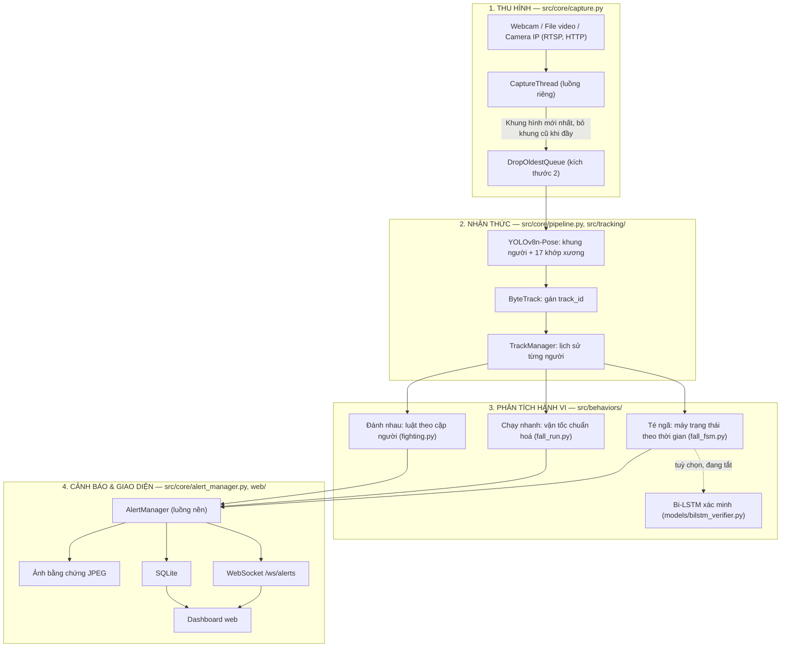
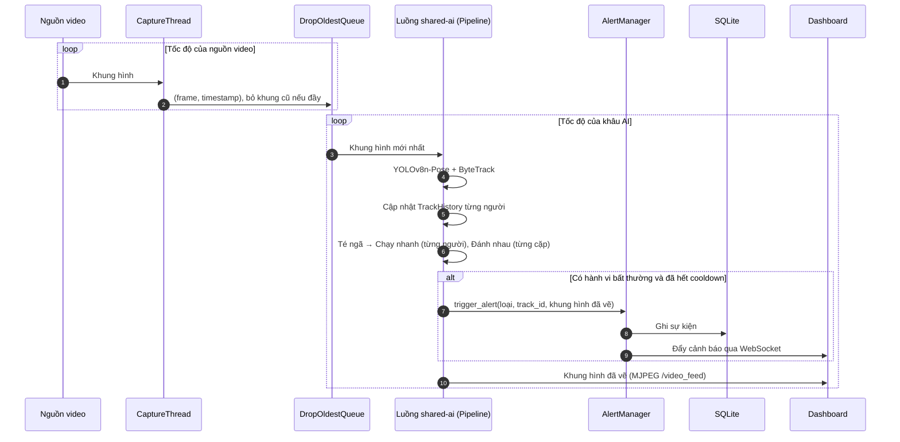
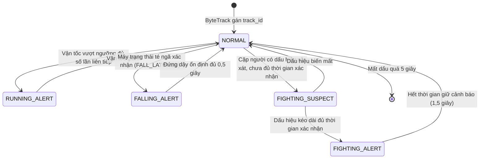
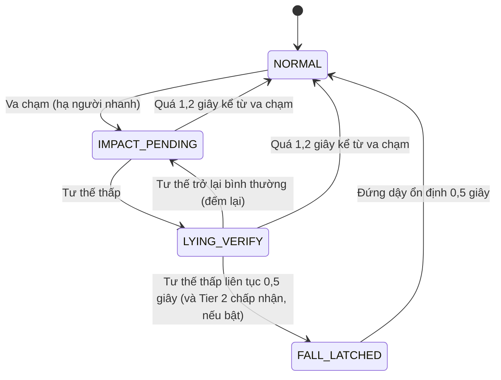
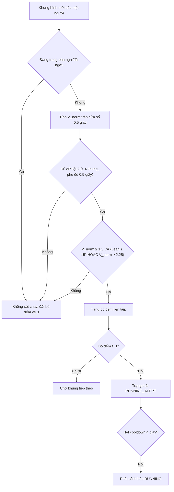
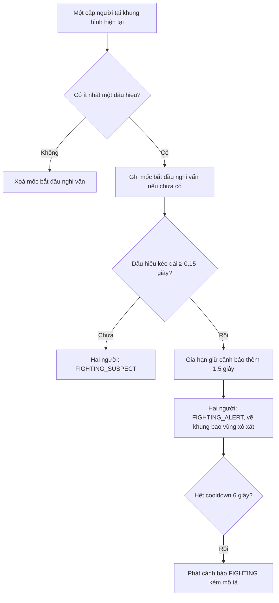
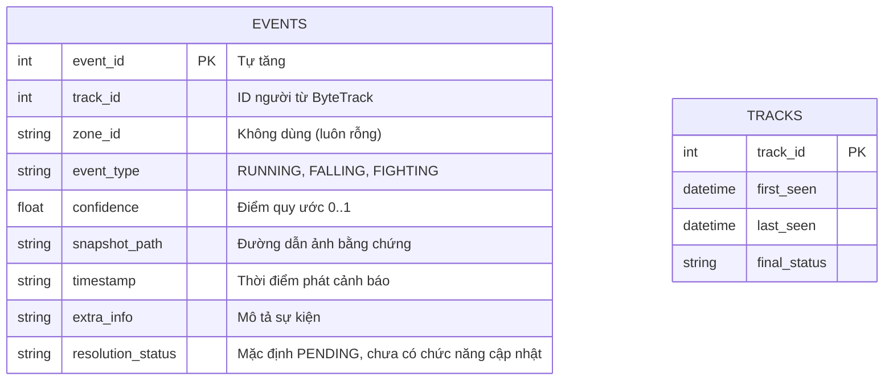

# CHƯƠNG 3: PHÂN TÍCH VÀ THIẾT KẾ HỆ THỐNG

Chương này mô tả hệ thống **đúng như mã nguồn hiện tại**. Mỗi mục ghi rõ file cài đặt tương ứng. Những phần đã thiết kế nhưng chưa hoàn thành được đánh dấu rõ.

---

## 3.1. Kiến trúc tổng thể

### 3.1.1. Kiến trúc 4 tầng



### 3.1.2. Vì sao tách luồng thu hình

Nếu đọc khung hình và chạy AI trong cùng một vòng lặp, khi AI chậm hơn tốc độ camera thì các khung hình chưa xử lý sẽ dồn lại trong bộ đệm, và hình ảnh hiển thị ngày càng trễ so với thực tế.

Hệ thống dùng mô hình **Producer – Consumer** với ba luồng:

| Luồng | File | Nhiệm vụ |
| :--- | :--- | :--- |
| `CaptureThread` | `src/core/capture.py` | Đọc nguồn video liên tục, gắn mốc thời gian cho từng khung hình, đẩy vào `DropOldestQueue`. Khi hàng đợi đầy, khung cũ nhất bị bỏ để nhường chỗ cho khung mới. Với file video, luồng tự điều tiết để phát đúng tốc độ gốc và tự phát lại từ đầu khi hết. |
| `shared-ai` | `src/core/shared_stream.py` | **Một** luồng duy nhất lấy khung mới nhất, chạy `SurveillancePipeline.process_frame`, mã hoá JPEG. Mọi trình duyệt đang xem đều nhận cùng một kết quả, nên mở nhiều tab không làm AI chạy nhiều lần. |
| Luồng cảnh báo | `src/core/alert_manager.py` | Mỗi cảnh báo được xử lý trên một luồng nền (ghi ảnh, ghi SQLite, đẩy WebSocket) để không làm chậm khâu AI. |

Hệ quả quan trọng: khâu AI có thể chạy chậm hơn camera và **bỏ qua khung hình**. Vì vậy mọi thuật toán hành vi đều tính theo **mốc thời gian thực** gắn với từng khung hình, không theo số khung hình.

### 3.1.3. Luồng dữ liệu thời gian thực



---

## 3.2. Quản lý đối tượng bám vết

### 3.2.1. Cấu trúc `TrackHistory` (`src/tracking/track_manager.py`)

Mỗi `track_id` có một bản ghi lưu trong RAM:

```python
@dataclass
class TrackHistory:
    track_id: int
    first_seen: float
    last_seen: float

    # Lịch sử 30 khung hình gần nhất
    foot_positions: deque            # trung điểm cạnh đáy bbox
    bbox_history: deque              # (x1, y1, x2, y2)
    timestamp_history: deque         # mốc thời gian thực của từng khung
    keypoints_history: deque         # ndarray (17, 3): x, y, độ tin cậy
    keypoint_bbox_history: deque     # bbox đi kèm từng bộ khớp
    keypoint_observed_history: deque # True: quan sát thật, False: sao chép từ khung trước
    missing_kpts_count: int
    last_valid_kpts_time: Optional[float]

    # Trạng thái máy trạng thái té ngã
    fall_phase: str                  # NORMAL | IMPACT_PENDING | LYING_VERIFY | FALL_LATCHED
    fall_impact_time, fall_lying_since, fall_recovery_since, fall_last_time
    fall_reference_height: Optional[float]
    fall_height_samples: deque
    fall_motion_samples: deque

    current_state: str               # trạng thái hiển thị (mục 3.2.3)
    last_alert_time: Dict[str, float]  # mốc cảnh báo gần nhất theo loại, dùng cho cooldown
```

### 3.2.2. Xử lý mất khớp xương và dọn dẹp

- **Bộ khớp hợp lệ:** đủ 17 khớp, giá trị hữu hạn, có ít nhất một khớp với độ tin cậy $\ge 0{,}3$.
- **Điền tạm (forward-fill):** khi một khung hình không có bộ khớp hợp lệ, bộ khớp gần nhất được sao chép lại, tối đa `max_missing_kpts = 5` khung và tối đa `max_fill_seconds = 0,25` giây. Các bản sao được đánh dấu là không quan sát thật; máy trạng thái té ngã không dùng chúng để tính góc thân hay vận tốc hông.
- **Xoá lịch sử khớp:** quá các giới hạn trên thì toàn bộ lịch sử khớp của người đó bị xoá, tránh dùng dữ liệu cũ.
- **Dọn track:** người không xuất hiện quá `track_ttl = 5` giây bị xoá khỏi bộ nhớ.
- **Đổi nguồn video:** pipeline xoá toàn bộ trạng thái bám vết và khởi tạo lại ByteTrack để ID không nối từ video cũ sang video mới.

### 3.2.3. Trạng thái hiển thị của một người



**Thứ tự ưu tiên** khi nhiều hành vi cùng xảy ra:
1. **Té ngã** được xét trước. Khi một người đang ở bất kỳ pha nào của máy trạng thái té ngã, hành vi chạy không được xét cho người đó (cú ngã luôn kèm chuyển động nhanh).
2. **Đánh nhau** được xét sau cho từng cặp; nó có thể ghi đè trạng thái chạy nhưng **không** ghi đè trạng thái té ngã đã khoá.

Màu khung trên video: xanh lá (bình thường), cam (chạy), đỏ (ngã), vàng (nghi đánh nhau), tím (đánh nhau).

---

## 3.3. Thuật toán phát hiện té ngã (`src/behaviors/fall_fsm.py`)

Các đại lượng $AR$, $\theta$, $H_{ref}$, $r$, $V_y$, $V_{top}$ và hai nhóm điều kiện *va chạm*, *tư thế thấp* được định nghĩa ở mục 2.3.3.

### 3.3.1. Máy trạng thái bốn pha



| Pha | Ý nghĩa | Điều kiện rời pha |
| :--- | :--- | :--- |
| `NORMAL` | Bình thường. Khi người đang đứng ($AR > 1{,}3$), hệ thống học chiều cao tham chiếu $H_{ref}$ (cần tối thiểu 0,3 giây quan sát). | Có *va chạm* → `IMPACT_PENDING`. |
| `IMPACT_PENDING` | Vừa hạ người nhanh, mở cửa sổ 1,2 giây chờ xem có nằm xuống không. $H_{ref}$ bị đóng băng. | *Tư thế thấp* → `LYING_VERIFY`. Hết cửa sổ → `NORMAL`. |
| `LYING_VERIFY` | Đang ở tư thế thấp, đếm thời gian. | Thấp liên tục 0,5 giây → xác nhận. Tư thế hết thấp → quay lại `IMPACT_PENDING`, bộ đếm bắt đầu lại. |
| `FALL_LATCHED` | Đã xác nhận ngã. Cảnh báo được **giữ** cho đến khi người đứng dậy. | $AR > 1{,}2$ và $r > 0{,}8$ và góc thân hết nằm ngang, liên tục 0,5 giây → `NORMAL`. |

### 3.3.2. Các xử lý biên

- **Khoảng trống quan sát:** nếu hai lần quan sát liên tiếp của một người cách nhau quá 0,3 giây, nghi vấn chưa xác nhận bị huỷ; cảnh báo đã khoá thì vẫn giữ.
- **Cooldown:** mỗi người chỉ phát một cảnh báo ngã trong 15 giây.
- **Điểm tin cậy:** khi không dùng Tier 2, cảnh báo mang điểm cố định 0,9. Đây là điểm quy ước, **không phải xác suất** đã hiệu chuẩn.

Mô tả chi tiết hơn và danh sách các trường hợp cần thử: `docs/fall_fsm.md`.

### 3.3.3. Tầng xác minh Bi-LSTM (Tier 2) — đã thiết kế, chưa hoàn thành

**Thiết kế:** khi máy trạng thái sắp xác nhận ngã, lấy 30 bộ khớp gần nhất, chuẩn hoá theo gốc hông và chiều cao khung (mục 2.4.1) thành ma trận $30 \times 34$, đưa qua mạng:

| Tầng | Cấu hình | Đầu ra |
| :--- | :--- | :--- |
| Bi-LSTM | 1 lớp, 64 đơn vị mỗi chiều | `(batch, 30, 128)`, lấy bước cuối → `(batch, 128)` |
| Dropout | 0,3 | `(batch, 128)` |
| Linear | 128 → 3 | Điểm 3 lớp: Bình thường, Chạy, Ngã |

Chỉ xác nhận ngã khi $P(\text{Ngã}) \ge 0{,}85$ (`bilstm_fall_threshold`).

**Trạng thái:** tắt (`enable_bilstm_tier2: false`). File `weights/fall_bilstm.pt` hiện có **không được huấn luyện bằng dữ liệu thật** và không được dùng.

**Các vấn đề phải giải quyết trước khi bật:**
1. Chưa có tập dữ liệu khớp xương có nhãn.
2. Script trích xuất lấy mọi khung hình ở FPS gốc của video, trong khi lúc chạy thật 30 bộ khớp gần nhất tương ứng với khoảng thời gian khác (khâu AI chạy khoảng 20 FPS trên CPU của máy thử, và thấp hơn khi có nhiều người). Cần lấy mẫu lại theo thời gian để hai bên khớp nhau.
3. Lịch sử khớp bị xoá khi mất khớp quá 0,25 giây, nên ngay sau cú ngã thường không đủ 30 bộ khớp và sự kiện sẽ bị từ chối.
4. Chia tập huấn luyện/kiểm tra phải theo **video**, không theo cửa sổ trượt, vì các cửa sổ chồng lên nhau.

---

## 3.4. Thuật toán phát hiện chạy nhanh (`src/behaviors/fall_run.py`)



Công thức $V_{norm}$ và độ đổ người: mục 2.3.2. Điểm tin cậy của cảnh báo là $\min(1, V_{norm} / 2{,}5)$ (điểm quy ước).

Tham số trong `configs/config.yaml`, mục `behaviors.running`:

| Tham số | Mặc định | Ý nghĩa |
| :--- | :---: | :--- |
| `v_norm_threshold` | 1,5 | Ngưỡng vận tốc (BH/s) |
| `body_lean_min` | 15,0 | Độ đổ người tối thiểu (độ); bỏ qua nếu vận tốc ≥ 1,5 lần ngưỡng |
| `window_seconds` | 0,5 | Cửa sổ đo vận tốc |
| `confirm_frames` | 3 | Số lần đo liên tiếp vượt ngưỡng |
| `cooldown_seconds` | 4,0 | Khoảng cách tối thiểu giữa hai cảnh báo của cùng một người |

---

## 3.5. Thuật toán phát hiện đánh nhau (`src/behaviors/fighting.py`)

### 3.5.1. Ba dấu hiệu

Với mỗi cặp người, sau khi loại các cặp chênh lệch phối cảnh (mục 2.3.4), hệ thống xét ba dấu hiệu. Ký hiệu $V_{th}$ = `limb_speed_threshold` (2,1 BH/s) và $V_{limb}$ là giá trị lớn hơn trong hai người.

| Dấu hiệu | Điều kiện |
| :--- | :--- |
| **Ra đòn** | Hai người gần nhau ($D_{norm} \le 1{,}15$ hoặc $IoU \ge 0{,}05$) **và** tay/chân vươn tới đối phương (trúng vùng đầu/thân/đá, hoặc $IoU \ge 0{,}05$, hoặc $D_{norm} \le 0{,}8$) **và** $V_{limb} \ge V_{th}$ |
| **Vật lộn** | Chồng lấn sâu ($IoU \ge 0{,}14$ hoặc $D_{norm} \le 0{,}62$) **và** thân giật lắc $A_{torso} \ge 1{,}15$ BH/s **và** $V_{limb} \ge 0{,}6 \cdot V_{th}$ |
| **Lao vào nhau** | $D_{norm} \le 0{,}85$ **và** vận tốc áp sát $V_{close} \ge 1{,}35$ BH/s **và** $V_{limb} \ge 0{,}75 \cdot V_{th}$ |

Cặp người được coi là **đang xô xát tại thời điểm đó** nếu có ít nhất một dấu hiệu.

### 3.5.2. Xác nhận, giữ cảnh báo và cooldown



- **Xác nhận theo thời gian** (`confirm_seconds = 0,15`) thay cho đếm khung hình, để kết quả ổn định khi FPS của khâu AI thay đổi.
- **Giữ cảnh báo** (`hold_seconds = 1,5`): vùng cảnh báo được giữ kể cả khi tín hiệu tạm mất hoặc ByteTrack tạm mất dấu một trong hai người.
- **Cooldown** (`cooldown_seconds = 6`) tính theo người có ID nhỏ hơn trong cặp.
- **Mô tả cảnh báo** được sinh theo dấu hiệu: đòn vào vùng đầu, cú đá, lao vào xô xát, giằng co vật lộn, hoặc vung tay.
- Cảnh báo đánh nhau được phát **sau** khi khung hình đã vẽ khung bao và banner, để ảnh bằng chứng thể hiện rõ vùng xô xát.

### 3.5.3. Giới hạn của phương pháp

Phương pháp cần **hai khung người riêng biệt**. Khi hai người vật lộn sát nhau hoặc nằm trên sàn, YOLO thường gộp họ thành một khung, và khi đó không còn cặp nào để xét. Trên clip mẫu `fight1.mp4` (vật lộn dưới sàn, 19 giây) hệ thống chỉ giữ được trạng thái cảnh báo trong một đoạn rất ngắn ở đầu clip. Ngoài ra chưa có bộ video âm tính (ôm, bắt tay, nhảy, thể thao) để đo tỷ lệ báo động giả.

Hướng cải thiện đang được cân nhắc: giữ các luật trên làm bước khoanh vùng nghi vấn, rồi dùng một mô hình phân loại clip ngắn trên vùng ảnh gộp của hai người để quyết định.

---

## 3.6. Cảnh báo, lưu trữ và giao diện

### 3.6.1. Chống lặp cảnh báo (Cooldown)

Khâu AI kiểm tra điều kiện ở mọi khung hình; nếu không giới hạn, một hành vi kéo dài sẽ sinh hàng trăm cảnh báo. Mỗi `TrackHistory` lưu mốc cảnh báo gần nhất theo từng loại:

$$\text{Được phát} = (t_{now} - t_{last}[\text{loại}]) \ge T_{cooldown}(\text{loại})$$

| Loại sự kiện | Cooldown |
| :--- | :---: |
| `RUNNING` | 4 giây |
| `FALLING` | 15 giây |
| `FIGHTING` | 6 giây |

Lưu ý: cooldown gắn với `track_id`. Nếu ByteTrack đổi ID của cùng một người, cảnh báo có thể lặp lại.

### 3.6.2. Xử lý một cảnh báo (`src/core/alert_manager.py`)

Trên một luồng nền, theo thứ tự:
1. Ghi ảnh bằng chứng `data/snapshots/<LOẠI>_<track_id>_<thời gian>.jpg` (khung hình đã vẽ khung người và khớp xương).
2. Ghi một dòng vào bảng `events` của SQLite.
3. Đẩy gói tin JSON qua WebSocket tới mọi dashboard đang mở:

```json
{
  "event_type": "RUNNING | FALLING | FIGHTING",
  "track_id": 3,
  "zone_id": "N/A",
  "confidence": 90.0,
  "timestamp": "2026-11-11 10:30:00",
  "snapshot_url": "/snapshots/FALLING_3_1793400000.jpg",
  "extra_info": "Mô tả sự kiện"
}
```

Trường `zone_id` là di sản của thiết kế cũ, luôn mang giá trị `"N/A"`.

### 3.6.3. Cơ sở dữ liệu (`src/database/db_service.py`)

SQLite, file `data/surveillance.db`, tự tạo khi chạy lần đầu.



- Bảng `tracks` được tạo nhưng **chưa có mã nào ghi vào**.
- Cột `resolution_status` chưa được dùng: giao diện chưa có nút xác nhận đã xử lý.
- Bộ đếm số cảnh báo theo loại được giữ trong RAM để vẽ lên video mà không truy vấn SQLite mỗi khung hình.

### 3.6.4. Máy chủ web (`web/app.py`)

| Đường dẫn | Phương thức | Chức năng |
| :--- | :---: | :--- |
| `/` | GET | Trang dashboard |
| `/video_feed` | GET | Luồng MJPEG của video đã vẽ khung |
| `/ws/alerts` | WebSocket | Kênh đẩy cảnh báo thời gian thực |
| `/api/events` | GET | 30 cảnh báo gần nhất (cùng định dạng với gói tin WebSocket) |
| `/api/events/stats` | GET | Tổng số cảnh báo và số theo từng loại |
| `/api/change_source` | POST | Đổi nguồn video. Nguồn mới mở lỗi thì giữ nguồn cũ và trả mã 400 |
| `/api/upload_video` | POST | Tải video lên (`.mp4`, `.avi`, `.mov`, `.mkv`) và phát luôn |
| `/snapshots/...` | GET | Ảnh bằng chứng |

Máy chủ không có xác thực người dùng; chỉ nên chạy trong mạng nội bộ.

### 3.6.5. Giao diện dashboard (`web/templates/index.html`, `web/static/`)

```text
+--------------------------------------------------------------------------------------+
|  HỆ THỐNG GIÁM SÁT (tiêu đề)                                   ONLINE   | 10:30:00   |
+--------------------------------------------------------------------------------------+
| [A] VIDEO TRỰC TIẾP                                | [B] CẢNH BÁO TỨC THỜI           |
|                                                    | +-----------------------------+ |
|   khung người + ID + trạng thái + 17 khớp xương    | | [ảnh] TÉ NGÃ (ID #1)   90%  | |
|   số đo chẩn đoán cạnh từng người (tắt được)       | |       2026-11-11 10:30:00   | |
|   banner cảnh báo hiện 4 giây khi có sự kiện       | |       mô tả sự kiện         | |
|                                                    | +-----------------------------+ |
| Nguồn video: [danh sách v]   [Tải video lên]       | | ...                         | |
+--------------------------------------------------------------------------------------+
| [C] Chạy: 0 | Té ngã: 0 | Ẩu đả: 0                                                   |
+--------------------------------------------------------------------------------------+
```

- **[A] Video:** luồng MJPEG. Trên video có bảng thông số (FPS của khâu AI, số người, tổng số cảnh báo). Tuỳ chọn `system.debug_overlay` hiện các số đo chẩn đoán cạnh từng người (AR, góc thân, vận tốc, tiến độ xác nhận), hữu ích khi chỉnh ngưỡng.
- **[B] Cột cảnh báo:** thẻ cảnh báo mới được chèn lên đầu, kèm ảnh thu nhỏ; bấm vào để xem ảnh lớn. Khi tải lại trang, lịch sử được nạp lại từ `/api/events`. Mỗi cảnh báo mới kèm âm thanh và giọng đọc tiếng Việt (nếu trình duyệt hỗ trợ).
- **[C] Thanh thống kê:** số cảnh báo theo từng loại.
- Kênh WebSocket tự kết nối lại khi mất kết nối.

---

## 3.7. Cấu hình (`configs/config.yaml`)

| Mục | Nội dung |
| :--- | :--- |
| `system` | Thiết bị suy luận (`device`, tự lùi về CPU khi không có CUDA), ngưỡng tin cậy phát hiện người, đường dẫn mô hình, bật/tắt Tier 2, bật/tắt số đo chẩn đoán |
| `camera` | Nguồn video, kích thước hàng đợi khung hình |
| `tracking` | Giới hạn điền tạm khớp xương, thời gian sống của track |
| `behaviors.running` | Ngưỡng chạy nhanh (mục 3.4) |
| `behaviors.falling` | Ngưỡng và các khoảng thời gian của máy trạng thái té ngã (mục 3.3) |
| `behaviors.fighting` | Ngưỡng đánh nhau (mục 3.5) |
| `web` | Địa chỉ, cổng, thư mục ảnh bằng chứng |

Mỗi hành vi có khoá `enabled` để bật/tắt riêng.
