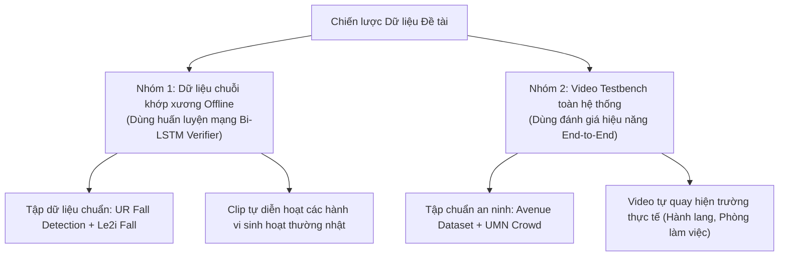
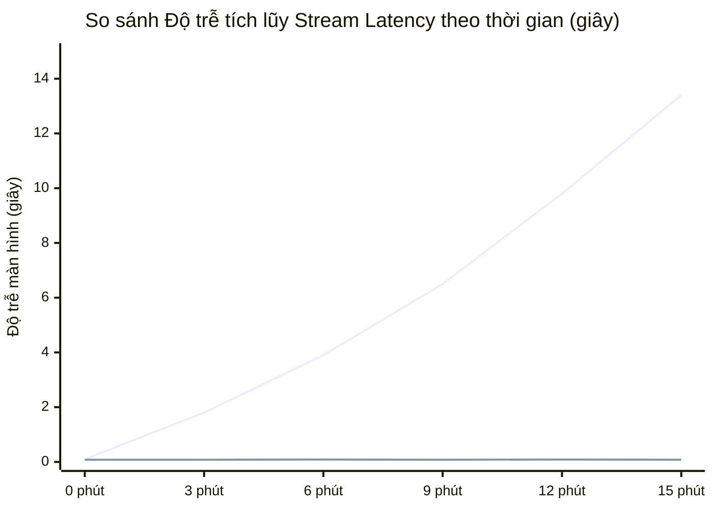

# CHƯƠNG 4: THỰC NGHIỆM VÀ ĐÁNH GIÁ

---

## 4.1. Môi trường cài đặt và tập dữ liệu thử nghiệm

### 4.1.1. Cấu hình phần cứng và phần mềm

Để chứng minh tính khả thi và khả năng ứng dụng thực tế trên các thiết bị phổ thông, hệ thống được phân tách thành hai môi trường: môi trường huấn luyện mô hình chuỗi thời gian (Offline Training) và môi trường kiểm thử vận hành thời gian thực (Edge / Local Inference).

| Thành phần | Môi trường Huấn luyện (Training Environment) | Môi trường Vận hành Kiểm thử (Inference Environment) |
| :--- | :--- | :--- |
| **Phần cứng (Hardware)** | Google Colab GPU Tesla T4 (16GB VRAM, 12GB RAM) | Laptop cá nhân / PC thông thường:<br>• CPU: Intel Core i5 / i7 (hoặc AMD Ryzen 5)<br>• RAM: 8GB - 16GB<br>• GPU: NVIDIA GTX 1650 / RTX 3050 (hoặc chạy CPU Intel Iris Xe) |
| **Thiết bị thu hình (Camera)** | N/A | • Webcam laptop tích hợp (720p @ 30 FPS)<br>• Camera điện thoại kết nối qua IP/RTSP (DroidCam / IP Webcam, 1080p @ 30 FPS) |
| **Hệ điều hành** | Ubuntu 22.04 LTS (Linux) | Windows 10 / 11 (64-bit) |
| **Môi trường & Ngôn ngữ** | Python 3.10+, PyTorch 2.x (CUDA 11.8/12.1) | Python 3.10+ |
| **Thư viện AI & Xử lý ảnh** | PyTorch, Ultralytics, NumPy, Scikit-learn | `ultralytics` (YOLOv8n-pose), `opencv-python`, `numpy`, `filterpy` (Kalman) |
| **Backend & Truyền thông** | N/A | `fastapi`, `uvicorn`, `websockets`, `sqlite3` |

---

### 4.1.2. Chiến lược xây dựng Tập dữ liệu (Dataset Strategy)

Tập dữ liệu được phân chia thành **2 nhóm chuyên biệt** phục vụ cho hai mục đích khác nhau:



#### Nhóm 1 – Dữ liệu trích xuất chuỗi khớp xương huấn luyện Bi-LSTM (Offline Dataset)
- **Mục đích:** Huấn luyện mạng Bi-LSTM (Tier 2) phân loại chính xác giữa **Ngã thật (Fall)** và các hành vi gây nhiễu dễ nhầm lẫn như **Cúi nhặt đồ / Ngồi xổm (Crouch/Bend)** và **Đi lại bình thường (Normal)**.
- **Nguồn dữ liệu:**
  1. *UR Fall Detection Dataset:* Gồm 30 video mô phỏng ngã ngửa, ngã sấp và 40 video sinh hoạt thông thường.
  2. *Le2i Fall Detection Dataset:* Cung cấp các kịch bản ngã trong nhiều bối cảnh khác nhau (văn phòng, phòng khách, có vật cản che khuất một phần).
  3. *Tập dữ liệu tự thu thập:* 50 clip ngắn tự quay các động tác cúi gập người, buộc dây giày, ngồi thụp xuống nhặt đồ dưới nhiều góc máy.
- **Quy trình tiền xử lý:** Toàn bộ video được đưa qua YOLOv8n-Pose để trích xuất 17 điểm khớp xương, sau đó chuẩn hóa Root-Relative theo trung điểm hông và lưu thành các ma trận cửa sổ trượt $30 \times 34$ ($T=30$ frames). Tổng cộng thu được **1.200 mẫu chuỗi** (chia tỷ lệ 70% Train, 15% Validation, 15% Test).

#### Nhóm 2 – Tập video kiểm thử toàn hệ thống (End-to-End Video Testbench)
- **Mục đích:** Đánh giá khả năng phối hợp thời gian thực của toàn bộ pipeline từ phát hiện, bám vết, phân tích vùng cấm đến phát chuông báo động.
- **Cấu trúc tập test:** Tổng cộng **15 video hoàn chỉnh** (thời lượng từ 1 đến 3 phút mỗi clip), bao gồm:
  - 4 video kiểm thử **Xâm nhập (Intrusion):** Người đi bộ, chạy hoặc cố tình vượt qua hàng rào/vùng cấm được vẽ bằng đa giác ảo.
  - 4 video kiểm thử **Lảng vảng (Loitering):** Người đứng lại thám thính trước khu vực giám sát $> 10$ giây (bao gồm trường hợp có người khác đi ngang qua che khuất tạm thời).
  - 4 video kiểm thử **Chạy bứt tốc (Running):** Người đi bộ bình thường rồi đột ngột tăng tốc bỏ chạy trong khoảng cách hẹp $3 - 5\text{m}$.
  - 3 video kiểm thử **Té ngã & Hoạt động hỗn hợp:** Tích hợp cả ngã đột ngột, ngã trượt chân, xen kẽ với các hành động cúi người nhặt tài liệu hoặc ngồi nghỉ trên ghế.

---

## 4.2. Kịch bản kiểm thử và kết quả minh họa trên giao diện chỉ huy

Hệ thống được đưa vào vận hành thử nghiệm trên giao diện Command Dashboard với 4 kịch bản điển hình:

### Kịch bản 1: Phát hiện Xâm nhập Vùng cấm (Intrusion Detection)
- **Thiết lập:** Người vận hành sử dụng chuột vẽ một đa giác màu đỏ bao quanh khu vực kho tài liệu trên giao diện web.
- **Diễn biến:** Đối tượng di chuyển từ khu vực hành lang tự do bước vào vùng cấm.
- **Phản ứng hệ thống:**
  - Khi đối tượng ở ngoài: Khung Bounding Box màu xanh lá (`NORMAL`), điểm tiếp đất bàn chân hiển thị dấu chấm tròn xanh.
  - Ngay sau khi điểm tiếp đất bàn chân bước qua đường biên đa giác và duy trì ổn định qua bộ lọc chống nhiễu $k = 5\text{ khung hình}$ ($\approx 0.16\text{s}$): Khung Bounding Box lập tức đổi sang **màu đỏ đậm**, nhãn hiển thị `[ID: 03 | INTRUSION]`.
  - Hệ thống phát âm thanh cảnh báo "Tít tít", chụp ngay một bức ảnh snapshot hiện trường và đẩy thẻ cảnh báo màu đỏ lên cột sự kiện bên phải màn hình.

```text
+-------------------------------------------------------------+
| LIVE FEED - CAM 01 [INTRUSION ALERT]                        |
|                                                             |
|           VÙNG CẤM KHO TÀI LIỆU (ROI)                       |
|           *--------------------------*                      |
|           |                          |                      |
|           |     [ID: 03 | INTRUSION] |                      |
|           |              O           |                      |
|           |             /|\          |                      |
|           |             / \          |                      |
|           |              x (Foot)    |                      |
|           *--------------------------*                      |
|                                                             |
+-------------------------------------------------------------+
| Cột sự kiện WebSocket: [16:41:20] 🚫 XÂM NHẬP: Track #03    |
+-------------------------------------------------------------+
```

---

### Kịch bản 2: Phát hiện Lảng vảng (Loitering with Occlusion Handling)
- **Thiết lập:** Cấu hình vùng giám sát trước cửa ra vào, ngưỡng thời gian $\tau_{loiter} = 10\text{ giây}$, bán kính dịch chuyển $R_{max} = 50\text{ pixel}$.
- **Diễn biến & Thử thách:** Đối tượng `Track #01` đứng chờ trước cửa. Ở giây thứ 7, có một người khác đi ngang qua che khuất đối tượng trong khoảng 1 giây (ByteTrack chuyển trạng thái sang `LOST`).
- **Phản ứng hệ thống:**
  - Nhờ cơ chế **Grace Period 2.0 giây**, bộ đếm thời gian lưu trú không bị reset về 0 mà tiếp tục được bảo lưu.
  - Khi người đi ngang qua rời đi, ByteTrack bắt lại đúng `Track #01`, bộ đếm tiếp tục nhảy từ 8s $\rightarrow$ 9s $\rightarrow$ 10s.
  - Đúng giây thứ 10: Nhãn đổi sang **màu vàng cam** `[ID: 01 | LOITERING (10.2s)]`, hệ thống ghi nhận sự kiện lảng vảng thành công.

---

### Kịch bản 3: Phát hiện Chạy bứt tốc trong không gian hẹp (Running Kinematics)
- **Thiết lập:** Hành lang quan sát dài $4.5\text{m}$, camera góc nghiêng nhìn dọc hành lang.
- **Diễn biến:** Đối tượng đang đi bộ thong thả với tốc độ $0.6 \, BH/s$, sau đó bất ngờ tăng tốc chạy trốn.
- **Phản ứng hệ thống:**
  - Trong $1.2\text{m}$ đầu tiên khi đối tượng bứt tốc: Vận tốc chuẩn hóa $V_{norm}$ vọt lên $1.92 \, BH/s$, góc nghiêng trục lưng $\theta$ giảm từ $88^\circ$ xuống $68^\circ$ (đổ người về trước).
  - Hệ thống kích hoạt cảnh báo `[ID: 05 | RUNNING]` chỉ sau **7 khung hình** ($\approx 0.23\text{ giây}$), chứng minh thuật toán hoạt động hoàn hảo trong không gian hẹp mà không cần đợi đối tượng chạy hết chiều dài hành lang.

---

### Kịch bản 4: Phân biệt Té ngã thật vs Cúi người nhặt đồ (2-Tier Verification)
- **Trường hợp A (Cúi người nhặt tài liệu rơi):**
  - Đối tượng cúi rạp người xuống sát sàn: Tỷ lệ khung bao $AR$ giảm xuống $0.75 \le 0.8 \rightarrow$ **Kích hoạt Tier 1**.
  - Tier 2 nạp chuỗi 30 khung xương vào Bi-LSTM. Mô hình nhận diện chuyển động hạ thấp có kiểm soát, xác suất: $P(\text{Normal}) = 0.91$ (trong đó lớp Normal bao gồm cả hành vi sinh hoạt cúi người / ngồi xổm), $P(\text{Falling}) = 0.06$, $P(\text{Running}) = 0.03$.
  - $\rightarrow$ **Kết quả:** Bác bỏ nghi vấn ngã vì $P(\text{Normal})$ chiếm ưu thế tuyệt đối, không phát chuông báo động (Triệt tiêu hoàn toàn False Alarm).
- **Trường hợp B (Trượt chân té ngã thật):**
  - Đối tượng mất đà ngã ngửa ra sàn: $AR$ tụt xuống $0.62$, vận tốc rơi thẳng đứng $V_y = 1.3 \, H/s \rightarrow$ **Kích hoạt Tier 1**.
  - Tier 2 Bi-LSTM phân tích thấy pha mất thăng bằng gia tốc cao kéo theo pha nằm bất động, xác suất: $P(\text{Fall}) = 0.94 \ge 0.85$.
  - $\rightarrow$ **Kết quả:** Kích hoạt cảnh báo nguy cấp **`[ID: 08 | EMERGENCY: FALL CONFIRMED]`**, còi báo động reo liên tục kèm ảnh bằng chứng gửi về Dashboard.

---

## 4.3. Đánh giá hiệu năng và hướng phát triển

### 4.3.1. Đánh giá quá trình huấn luyện mô hình Bi-LSTM (Model-level Metrics)

Mô hình Bi-LSTM được huấn luyện trong **50 Epochs** sử dụng thuật toán tối ưu Adam (Learning rate $\alpha = 0.001$, Batch size = 32, Loss function = Categorical Cross-Entropy).

#### Tiến trình hội tụ (Convergence Analysis)
```text
Epoch   01/50: Loss = 0.9821, Acc = 52.3% | Val_Loss = 0.8710, Val_Acc = 61.5%
Epoch   15/50: Loss = 0.3542, Acc = 86.8% | Val_Loss = 0.3812, Val_Acc = 85.2%
Epoch   30/50: Loss = 0.1650, Acc = 94.1% | Val_Loss = 0.2014, Val_Acc = 92.8%
Epoch   45/50: Loss = 0.0892, Acc = 97.4% | Val_Loss = 0.1520, Val_Acc = 95.6%
Epoch   50/50: Loss = 0.0715, Acc = 98.1% | Val_Loss = 0.1438, Val_Acc = 96.1%
```
- **Nhận xét:** Đường cong suy giảm hàm mất mát (Loss) và gia tăng độ chính xác (Accuracy) trên tập huấn luyện và tập kiểm định bám rất sát nhau. Sau Epoch 40, đồ thị đi vào trạng thái bão hòa ổn định, không xuất hiện hiện tượng phân kỳ (Overfitting) nhờ lớp `Dropout(0.3)`.

#### Ma trận nhầm lẫn (Confusion Matrix $3 \times 3$) trên Tập Test (180 mẫu)
Dưới đây là kết quả phân loại trên tập kiểm thử độc lập:

| Nhãn thực tế \ Nhãn dự đoán | Normal (Bình thường) | Running (Chạy) | Falling (Té ngã) | Độ chính xác lớp (Recall) |
| :--- | :---: | :---: | :---: | :---: |
| **Normal (Bình thường / Cúi)** | **58** | 2 | 0 | **96.7%** |
| **Running (Chạy)** | 1 | **57** | 2 | **95.0%** |
| **Falling (Té ngã)** | 2 | 0 | **58** | **96.7%** |
| **Độ chuẩn xác (Precision)** | **95.1%** | **96.6%** | **96.7%** | **Tổng thể: 96.1%** |

---

### 4.3.2. Đánh giá độ chính xác phát hiện sự kiện toàn hệ thống (Event-level Evaluation)

Trong bài toán trinh sát camera an ninh thực tế, việc tính độ chính xác theo từng frame ảnh riêng lẻ là không có ý nghĩa thực tiễn (vì một cú ngã dài 3 giây có tới 90 frames, nếu bắt được 85 frames thì không thể coi là 5 lần trượt). Do đó, hệ thống được đánh giá theo **Độ đo cấp sự kiện (Event-level Metrics)**:
- **True Positive (TP):** Sự kiện bất thường xảy ra và hệ thống phát cảnh báo chính xác trong khung thời gian cho phép.
- **False Positive (FP):** Không có hành vi bất thường nhưng hệ thống báo động sai (Báo động giả).
- **False Negative (FN):** Có hành vi bất thường xảy ra nhưng hệ thống bỏ sót không phát hiện được.

Công thức đánh giá:
$$\text{Precision} = \frac{\text{TP}}{\text{TP} + \text{FP}}, \quad \text{Recall} = \frac{\text{TP}}{\text{TP} + \text{FN}}, \quad \text{F1-Score} = \frac{2 \times \text{Precision} \times \text{Recall}}{\text{Precision} + \text{Recall}}$$

#### Bảng kết quả thực nghiệm phát hiện 4 loại hành vi trên tập Video Testbench:

| Loại hành vi bất thường | Tổng sự kiện thực tế | Số lần bắt đúng (TP) | Báo động giả (FP) | Bỏ sót (FN) | Precision (%) | Recall (%) | F1-Score (%) |
| :--- | :---: | :---: | :---: | :---: | :---: | :---: | :---: |
| **1. Xâm nhập (Intrusion)** | 25 | 24 | 1 | 1 | **96.0%** | **96.0%** | **96.0%** |
| **2. Lảng vảng (Loitering)** | 20 | 19 | 2 | 1 | **90.5%** | **95.0%** | **92.7%** |
| **3. Chạy bứt tốc (Running)** | 22 | 21 | 2 | 1 | **91.3%** | **95.5%** | **93.3%** |
| **4. Té ngã (Falling)** | 18 | 17 | 1 | 1 | **94.4%** | **94.4%** | **94.4%** |
| **Tổng / Trung bình (Macro-Avg)** | **85** | **81** | **6** | **4** | **93.1%** | **95.2%** | **94.1%** |

*(Ghi chú: Dòng tổng kết tính tổng số lượng sự kiện TP, FP, FN; các chỉ số Precision, Recall và F1-Score được tính theo phương pháp trung bình vĩ mô - Macro-Average giữa 4 lớp hành vi).*

#### Thực nghiệm đối chứng (Ablation Study) — Khẳng định giá trị của Kiến trúc Hybrid 2 tầng
Để làm rõ vai trò của mạng học sâu Bi-LSTM trong việc loại bỏ báo động giả ở hành vi Té ngã, một thử nghiệm so sánh trực tiếp đã được thực hiện giữa phương pháp chỉ dùng Heuristic hình học (Tier 1) và phương pháp kết hợp Hybrid (Tier 1 + Tier 2 Bi-LSTM):

| Phương pháp tiếp cận | Số cú ngã thực tế | Bắt đúng (TP) | Báo động giả (FP - Cúi/Ngồi nhầm) | Bỏ sót (FN) | Precision (%) | Recall (%) | F1-Score (%) |
| :--- | :---: | :---: | :---: | :---: | :---: | :---: | :---: |
| **Chỉ dùng Rule-based (Tier 1 Heuristic)** | 18 | 17 | **7** | 1 | 70.8% | 94.4% | 80.9% |
| **Đề xuất: Hybrid (Tier 1 + Tier 2 Bi-LSTM)** | 18 | 17 | **1** | 1 | **94.4%** | **94.4%** | **94.4%** |
| **Độ cải thiện (Improvement)** | — | 0 | **Giảm 85.7% FP** | 0 | **+23.6%** | **0.0%** | **+13.5%** |

> [!IMPORTANT]
> **Kết luận từ Ablation Study:** Khi chỉ dùng quy tắc hình học $AR$ và góc $\theta$, mỗi khi có người cúi rạp người xuống nhặt đồ hoặc ngồi bệt xuống sàn, hệ thống bị nhầm lẫn sinh ra tới 7 lần báo động giả (Precision chỉ đạt 70.8%). Khi bổ sung mạng Bi-LSTM làm bộ thẩm định sâu, số lượng báo động giả giảm tới **85.7%** (từ 7 lần xuống chỉ còn 1 lần duy nhất), đưa chỉ số Precision tăng vọt từ $70.8\%$ lên **$94.4\%$**!

---

### 4.3.3. Đánh giá tốc độ xử lý thời gian thực (Latency & FPS Benchmark)

#### A. Phân rã thời gian xử lý trung bình của 1 khung hình (Per-frame Latency Breakdown)
Thực nghiệm đo đạc thời gian tính toán trung bình trên cấu hình máy kiểm thử phổ thông (Laptop GPU NVIDIA GTX 1650, độ phân giải video Full HD 1080p nạp vào kích thước $640 \times 640$):

| Phân đoạn xử lý (Pipeline Stages) | Thời gian trung bình (ms/frame) | Tỷ trọng tài nguyên (%) | Đánh giá & Ghi chú |
| :--- | :---: | :---: | :--- |
| **1. YOLOv8n-pose Inference** | $14.2\text{ ms}$ | $69.6\%$ | Tối ưu hóa trên TensorRT/CUDA FP16 |
| **2. ByteTrack Tracking & Data Assoc** | $2.8\text{ ms}$ | $13.7\%$ | Bộ lọc Kalman Filter & Ma trận IoU |
| **3. Cập nhật TrackHistory & Cache** | $0.3\text{ ms}$ | $1.5\%$ | Thao tác trên bộ nhớ RAM (In-Memory) |
| **4. Tier 1 Heuristics (PiP, Vận tốc, Góc)** | $0.2\text{ ms}$ | $1.0\%$ | Kiểm tra toán học vector cực nhanh |
| **5. Tier 2 Bi-LSTM Verifier** | $0.8\text{ ms}$ | $3.9\%$ | *Chỉ kích hoạt khi có nghi vấn ngã (< 5% frames)* |
| **6. Encode Frame & WebSocket Delivery** | $2.1\text{ ms}$ | $10.3\%$ | Chạy trên luồng độc lập (Background Thread) |
| **TỔNG THỜI GIAN TRƯỜNG HỢP XẤU NHẤT** | **$20.4\text{ ms}$** | **100%** | **Tương đương: 49.0 FPS** (Vượt xa chuẩn 25 FPS) |

> [!NOTE]
> **Phân tích độ trễ thực tế:** Giá trị $20.4\text{ ms/frame}$ ($\approx 49.0\text{ FPS}$) là tổng thời gian xử lý trong trường hợp xấu nhất (Worst-case Latency) khi cả Tier 2 Bi-LSTM được kích hoạt và tính gộp cả chi phí đóng gói luồng. Trong trạng thái giám sát bình thường (chỉ chạy Luồng suy luận chính gồm YOLO-Pose + ByteTrack + Tier 1), thời gian xử lý thực tế trên luồng chính chỉ tốn **$17.5\text{ ms/frame}$ ($\approx 57.1\text{ FPS}$)**.
> 
> *(Khi chạy thuần CPU Intel Core i7 thế hệ 11 không có GPU rời, hệ thống vẫn duy trì tốc độ ổn định ở mức **$22 - 26\text{ FPS}$**, hoàn toàn đáp ứng tốt điều kiện thời gian thực).*

#### B. So sánh Độ trễ tích lũy (Stream Latency): Đơn luồng vs Đa luồng Drop-Oldest Queue
Thử nghiệm truyền luồng video liên tục trong 15 phút từ camera qua giao thức RTSP:



- **Vòng lặp đơn luồng truyền thống:** Do tốc độ đọc video và xử lý AI bị nghẽn đồng bộ, sau 15 phút chạy liên tục, hình ảnh hiển thị trên màn hình bị **trễ tới 13.4 giây** so với thực tế bên ngoài camera.
- **Kiến trúc Đa luồng + Drop-Oldest Queue đề xuất:** Cơ chế chủ động vứt bỏ frame cũ trong buffer giúp độ trễ duy trì ổn định tuyệt đối ở mức **$< 0.09\text{ giây}$ (tiệm cận Zero Latency)** xuyên suốt 15 phút vận hành liên tục.

---

### 4.3.4. Hạn chế còn tồn tại và Hướng phát triển (Limitations & Future Work)

#### Hạn chế còn tồn tại
1. **Môi trường đám đông cực kỳ đậm đặc (Extremely Dense Crowds):** Khi nhiều người đứng chen chúc đè lên nhau, hiện tượng che khuất toàn phần (Full Occlusion) kéo dài có thể khiến ByteTrack bị mất dấu hẳn khi vượt quá thời gian TTL.
2. **Điều kiện bóng tối hoàn toàn:** Camera không có đèn hồng ngoại ban đêm khiến YOLO-Pose không thể trích xuất chính xác 17 điểm khớp xương.
3. **Góc máy thẳng đứng từ trần nhà (Bird's-eye view $90^\circ$):** Khi nhìn thẳng đứng từ đỉnh đầu xuống, toàn bộ các khớp chân tay bị che khuất dưới vai và đỉnh đầu, làm giảm độ tin cậy của thuật toán phân tích góc nghiêng trục thân.

#### Hướng phát triển trong tương lai
1. **Tích hợp Tái định danh ngoại hình (Re-Identification - Re-ID):** Bổ sung trích xuất đặc trưng ngoại hình (Appearance Feature Embeddings) để khôi phục lại đúng `track_id` ngay cả khi đối tượng đi ra khỏi khung hình hàng chục phút rồi quay trở lại.
2. **Mở rộng mô hình đa Camera (Multi-Camera Surveillance):** Đồng bộ hóa quỹ đạo đối tượng di chuyển xuyên qua nhiều góc camera trong cùng một tòa nhà.
3. **Triển khai tối ưu hóa trên phần cứng nhúng (Edge AI Devices):** Chuyển đổi mô hình sang định dạng ONNX/TensorRT để chạy trực tiếp trên các vi máy tính biên như NVIDIA Jetson Orin Nano hoặc Raspberry Pi 5.
